# Learn Zig ⚡

<div align="center">

[](https://opensource.org/licenses/MIT)
[](https://ziglang.org/)
[](https://github.com/TheLearningHubOrg/learn-zig/actions/workflows/ci.yml)
[](https://github.com/TheLearningHubOrg/learn-zig/releases)
[](https://ziglang.org/documentation/0.17.0/)

**From your first `zig build` to staff-level Zig: explicit memory, comptime generics, the `std.Io` interface and C interop, taught with code that compiles on Zig 0.17.**  
Allocators and arenas, error unions and `errdefer`, comptime reflection, tagged unions, the build system and packages, cross-compilation, `translate-c`, and a real HTTP service you can run and test.

[Getting Started](#1-stage-1-toolchain-syntax--types) • [Data & Modules](#2-stage-2-functions-data-structures--modules) • [Memory & Comptime](#3-stage-3-memory-errors--comptime-generics) • [Concurrency](#4-stage-4-concurrency--the-io-interface) • [I/O & Testing](#5-stage-5-io-networking-http--testing) • [Shipping](#6-stage-6-performance-safety-c-interop--shipping) • [Interview Prep](#7-stage-7-staff-zig-systems-engineer-interview-handbook--cheatsheet)

<br/>

<a href="https://www.buymeacoffee.com/manthanank">
  
</a>

</div>

---

> **Language used in this guide.** Every example, the starter project and its tests are written in Zig, because the point is to learn Zig itself and its own toolchain: `zig build` is the build system, `zig test` is the test runner and `zig fmt` is the formatter, so nothing else is needed. The only other languages that appear are C (in the interop sections, since calling C is a core Zig use case), shell commands, the Dockerfile and the CI YAML. Every snippet in Stages 1-4 is a copy of a test in [`examples/`](examples/) or of the starter in [`src/`](src/), and CI compiles and runs all of them on Zig 0.17.0.

## 🗺️ 7-Stage Pedagogical Roadmap

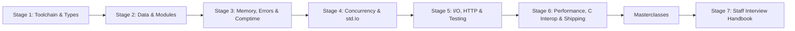

| Stage | Focus Domain | Core Concepts & Engineering Outcomes |
| :--- | :--- | :--- |
| **Stage 1** | **Toolchain, Syntax & Types** | `zig init`, `zig build run/test`, `zig fmt`, `build.zig.zon` fingerprints; `const`/`var`, `u7`/`i3` arbitrary-width integers, `+%`/`+\|` and `@intCast`/`@truncate`, arrays vs slices vs `[:0]` strings, optionals with `orelse` and `.?`, labeled blocks and exhaustive `switch`. Outcome: build, run and test the starter HTTP service. |
| **Stage 2** | **Functions, Data Structures & Modules** | Structs with methods and decl literals (`.init`, `.empty`), enums, tagged unions and `inline else`, `std.ArrayList` with an allocator per call, `StringHashMapUnmanaged`, `array_hash_map.Auto`, `MultiArrayList`, the `next() ?T` iterator convention, `{f}` format methods and `std.Io.Writer`, `@import`, `b.addModule` and `zig fetch --save`. Outcome: model a domain and split it into modules. |
| **Stage 3** | **Memory, Errors & Comptime Generics** | The `std.mem.Allocator` vtable, `ArenaAllocator`, `FixedBufferAllocator`, `SafeAllocator`, `BufferFirstAllocator`, `std.testing.allocator` leak checks, `defer`/`errdefer`, error sets and `\|\|`, inferred error sets, `*T`/`[*]T`/`[]T`/`*[N]T`, `align(n)`, comptime parameters, functions returning `type`, `@typeInfo` (struct-of-arrays form), `extern` and `packed` layout, build modes and illegal behavior. Outcome: write allocation-correct, generic code. |
| **Stage 4** | **Concurrency & the Io Interface** | `std.Io` as a parameter like `Allocator`, `Io.Threaded` vs `Io.Evented`, `io.async`/`io.concurrent`, `Future.await`/`cancel`, `Io.Group`, `Io.Mutex`, `Io.Queue`, cancelation points, `std.Thread` and `std.atomic.Value`. Outcome: serve many connections without data races. |
| **Stage 5** | **I/O, Networking, HTTP & Testing** | The buffered `std.Io.Reader`/`Writer` interfaces, `Io.Dir` and `Io.File`, `Io.net.IpAddress.listen`, `std.http.Server` and `Client`, `std.json`, `std.zon`, test blocks, `std.testing.io`, fuzzing with `std.testing.fuzz`. Outcome: a tested network service and CLI. |
| **Stage 6** | **Performance, Safety, C Interop & Shipping** | `-Doptimize=debug/safe/fast/small`, `@Vector` SIMD, profiling with `perf`, the official `translate-c` package replacing the removed `@cImport`, `zig cc`, `-Dtarget=` cross-compilation, static musl binaries, distroless images. Outcome: ship a fast, small, cross-platform binary. |
| **Masterclasses** | **Deep dives (added in the next revision)** | Comptime internals, allocator design, the `std.Io` event loop, C library wrapping, and a flagship build that uses the whole guide. |
| **Stage 7** | **Staff Interview Handbook** | Interview Q&As on internals, design trade-offs and production debugging, plus a one-page cheatsheet. |

---

## 🆕 Zig Versions, What's New & Migration

Zig is pre-1.0. Every minor release (0.14, 0.15, 0.16, 0.17) can and does break source compatibility, and only the latest release gets bug-fix point releases. Pin the compiler version in `build.zig.zon` (`minimum_zig_version`) and in CI, and upgrade one minor version at a time.

### V.1 Release Timeline

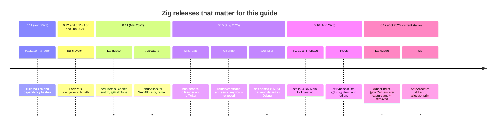

### V.2 Compatibility Matrix

| Zig | Released | Status | Bundled LLVM | Debug backend on x86_64 Linux | Notes |
| --- | --- | --- | --- | --- | --- |
| 0.17.0 | 2026-10-01 | Current stable, used by this guide | LLVM 22 | Self-hosted | `std.lang` replaces `std.builtin`; `-Doptimize=safe` style names |
| 0.16.0 | 2026-04-13 | Unsupported once 0.17 shipped | LLVM 21 | Self-hosted | `std.Io` interface, `pub fn main(init: std.process.Init)` |
| 0.15.2 | 2025-10-11 | Unsupported | LLVM 20 | Self-hosted | New `Io.Reader`/`Io.Writer`; unmanaged `ArrayList` by default |
| 0.14.1 | 2025-05-21 | Unsupported | LLVM 19 | LLVM | `.name = .enum_literal` and `.fingerprint` in `build.zig.zon` |
| 0.13.0 | 2024-06-07 | Unsupported | LLVM 18 | LLVM | Many tutorials online still target this version |

Older tutorials are the main source of confusion. If a snippet uses `std.io.getStdOut()`, `std.heap.GeneralPurposeAllocator`, `usingnamespace` or `@Type(.{ ... })`, it was written for 0.14 or earlier and will not compile on 0.17.

### V.3 What's New in 0.17

#### `@backingInt` and `@fromBackingInt` replace `@intFromEnum` and `@enumFromInt`

The new builtins work on enums and on packed types that declare a backing integer, so one pair of names covers both. `zig fmt` rewrites the old calls for you.

```zig
const Status = enum(u16) { ok = 200, not_found = 404 };

// 0.16
const code_old: u16 = @intFromEnum(Status.not_found);
const status_old: Status = @enumFromInt(200);

// 0.17
const code: u16 = @backingInt(Status.not_found);
const status: Status = @fromBackingInt(200);
```

#### Array multiplication `**` is gone; use `@splat`

```zig
// 0.16
var row = [1]u8{0} ** 64;

// 0.17
var row: [64]u8 = @splat(0);
```

#### `errdefer |err|` capture removed

You can no longer read the error inside an `errdefer`. Wrap the body in an inner function and handle the error at the call site instead.

```zig
// 0.16
fn job() void {
    errdefer |err| std.log.err("job failed: {t}", .{err});
    try step();
}

// 0.17
fn job() void {
    jobInner() catch |err| std.log.err("job failed: {t}", .{err});
}
fn jobInner() !void {
    try step();
}
```

#### `SafeAllocator` replaces `DebugAllocator`

`std.heap.SafeAllocator` is thread-safe, reports every leak from `deinit`, never reuses freed memory (so most use-after-free writes fault or are detected), and checks a canary so memory freed into the wrong allocator panics. `DebugAllocator` still compiles but is deprecated. Juicy Main hands you a `SafeAllocator` as `init.gpa` in debug and safe builds.

```zig
// 0.16
var dbg: std.heap.DebugAllocator(.{}) = .init;
defer _ = dbg.deinit();
const gpa = dbg.allocator();

// 0.17
var safe: std.heap.SafeAllocator = .init(std.heap.page_allocator, .{});
defer _ = safe.deinit(); // returns the number of leaks
const gpa = safe.allocator();
```

#### `std.fmt.allocPrint` moved onto `Allocator`

```zig
// 0.16
const line = try std.fmt.allocPrint(gpa, "{s}={d}", .{ key, value });

// 0.17
const line = try gpa.print("{s}={d}", .{ key, value });
```

#### Struct-of-arrays reflection

`@typeInfo` on a struct, enum or union now returns parallel slices (`field_names`, `field_types`, `field_attrs`) instead of an array of field structs.

```zig
// 0.16
inline for (@typeInfo(T).@"struct".fields) |field| {
    std.debug.print("{s}: {s}\n", .{ field.name, @typeName(field.type) });
}

// 0.17
const info = @typeInfo(T).@"struct";
inline for (info.field_names, info.field_types) |name, FieldType| {
    std.debug.print("{s}: {s}\n", .{ name, @typeName(FieldType) });
}
```

#### `std.builtin` becomes `std.lang`, and optimize modes lose the `Release` prefix

`std.lang.Optimize` has the tags `.debug`, `.safe`, `.fast` and `.small`. On the command line that means `zig build -Doptimize=safe`. The old names still parse for now, but comparisons such as `builtin.mode == .ReleaseSafe` no longer compile.

```zig
// 0.16
if (builtin.mode == .ReleaseFast) {}

// 0.17
if (builtin.mode == .fast) {}
```

#### Smaller changes

- `@divCeil(a, b)` rounds integer division towards positive infinity.
- `@hasDecl` only sees `pub` declarations, even from the same file.
- `void{}` is gone; write `{}`.
- `ArrayList.getLast()` and `getLastOrNull()` are deprecated in favour of `last()`, which returns an optional.
- `std.heap.StackFallbackAllocator` is now `BufferFirstAllocator`, and you pass the buffer in.
- `std.zon.parse.fromSlice` takes a struct of options and allocates from an arena.
- `@cImport`, deprecated in 0.16, is removed. `b.addTranslateC` still works but is deprecated in favour of the official `translate-c` package (`zig fetch --save git+https://codeberg.org/ziglang/translate-c#zig-0.17.x`), which has its own release cadence and more options.

### V.4 Migration Guide (0.15 → 0.16 → 0.17)

Upgrade one minor version at a time. Each step is: install, run `zig fmt` (it performs the mechanical rewrites), build, fix what the compiler reports, run the tests.

```bash
# 1. Install the next release next to the current one and check it.
zig version                      # 0.15.2
curl -fsSLO https://ziglang.org/download/0.16.0/zig-x86_64-linux-0.16.0.tar.xz
tar -xf zig-x86_64-linux-0.16.0.tar.xz && export PATH="$PWD/zig-x86_64-linux-0.16.0:$PATH"
zig version                      # 0.16.0

# 2. Let zig fmt apply the rewrites it knows about, then build and test.
zig fmt build.zig src
zig build test 2>&1 | head -50

# 3. Bump the floor so older compilers fail fast with a clear message.
sed -i 's/.minimum_zig_version = ".*"/.minimum_zig_version = "0.16.0"/' build.zig.zon

# 4. Repeat for 0.17.0.
```

The 0.15 → 0.16 step is the large one, because every API that blocks now takes an `Io`:

| 0.15 code | 0.16 / 0.17 code |
| --- | --- |
| `pub fn main() !void` plus a hand-made allocator | `pub fn main(init: std.process.Init) !void`, then `init.gpa`, `init.arena`, `init.io` |
| `std.process.argsAlloc(gpa)` | `init.minimal.args.toSlice(init.arena.allocator())` |
| `std.process.getEnvVarOwned(gpa, "PORT")` | `init.environ_map.get("PORT")` |
| `std.fs.File.stdout().writer(&buf)` | `std.Io.File.Writer.init(.stdout(), io, &buf)` |
| `std.fs.cwd().openFile(path, .{})` | `std.Io.Dir.cwd().openFile(io, path, .{})` |
| `std.net.Address.parseIp(...)` then `listen` | `std.Io.net.IpAddress.parse(...)` then `address.listen(io, .{})` |
| `std.Thread.Pool` and `WaitGroup` | `std.Io.Group` with `group.async(io, f, args)` and `group.await(io)` |
| `std.mem.indexOf`, `indexOfScalar` | `std.mem.find`, `findScalar` (the old names are deprecated) |
| `std.AutoArrayHashMap(K, V)` | `std.array_hash_map.Auto(K, V)` (unmanaged) |
| `@Type(.{ .int = .{ ... } })` | `@Int(.unsigned, 7)` and the other type-creating builtins |
| `@cImport({ @cInclude("x.h"); })` | A `c.h` header translated in `build.zig` (the `translate-c` package on 0.17, `b.addTranslateC` on 0.16), imported with `@import("c")` |

If a library has no `Io` parameter to pass down, `var threaded: std.Io.Threaded = .init_single_threaded; const io = threaded.io();` works as a temporary bridge, the same way `page_allocator` works when no allocator is plumbed through. Treat it as a migration crutch and thread a real `Io` through afterwards.

### V.5 Deprecations & Breaking Changes

| Version | Deprecated / removed | Replacement | What breaks and how to fix it |
| --- | --- | --- | --- |
| 0.17 | `a ** n` array multiplication | `@splat(value)` with a result type | Syntax error at the `**`; give the variable an array type and use `@splat` |
| 0.17 | `errdefer \|err\|` | Inner function plus `catch \|err\|` at the call site | `expected block or expression, found '\|'` |
| 0.17 | `@intFromEnum`, `@enumFromInt` (deprecated) | `@backingInt`, `@fromBackingInt` | Still compile today; `zig fmt` rewrites them |
| 0.17 | `std.heap.DebugAllocator` (deprecated) | `std.heap.SafeAllocator` | Different `init` signature; `deinit` returns a leak count |
| 0.17 | `std.fmt.allocPrint` | `allocator.print` | Unknown declaration; call `gpa.print(fmt, args)` |
| 0.17 | `std.builtin.OptimizeMode.ReleaseSafe` and friends in comparisons | `.safe`, `.fast`, `.small`, `.debug` | `==` against the old tag fails to compile |
| 0.17 | `@cImport` (removed), `std.Build.Step.TranslateC` (deprecated) | The `translate-c` package and its `Translator` | Unknown builtin; move the includes to a header and translate it in `build.zig` |
| 0.17 | `void{}`, `i0`, `link_once`/`internal` linkage | `{}`, `u0`, `weak` or no export | Syntax or type errors |
| 0.16 | `@Type` | `@Int`, `@Struct`, `@Enum`, `@Pointer`, `@Fn`, `@Tuple`, `@Union`, `@EnumLiteral` | `@Type` is an unknown builtin |
| 0.16 | Global `std.os.environ`, `std.process.args()` | `std.process.Init` / `Init.Minimal` passed to `main` | Functions that read env vars need them passed in |
| 0.16 | `std.Thread.Pool` | `std.Io.Group`, `io.async`, `io.concurrent` | Unknown declaration |
| 0.16 | Managed `ArrayHashMap`, `PriorityQueue` with an allocator field | Unmanaged versions with `.empty` | Pass the allocator to every mutating call |
| 0.16 | `@cImport` (deprecated) | `b.addTranslateC` | Still worked in 0.16; removed in 0.17 |
| 0.15 | `usingnamespace` | Explicit `pub const x = other.x;` re-exports | Syntax error |
| 0.15 | `async`/`await` keywords | `std.Io` futures (0.16) | Syntax error |
| 0.15 | Generic `std.io.Reader(...)`/`Writer(...)`, `BoundedArray` | `std.Io.Reader`/`std.Io.Writer` with a caller buffer; a plain array plus a length or `ArrayList.initBuffer` | Type errors across I/O code |
| 0.15 | `"{}"` calling a `format` method | `"{f}"` and `fn format(self, w: *std.Io.Writer) !void` | Compile error asking for a format specifier |

---

## 📋 Table of Contents

- [🆕 Zig Versions, What's New & Migration](#-zig-versions-whats-new--migration)
- [1. Stage 1: Toolchain, Syntax & Types](#1-stage-1-toolchain-syntax--types)
  - [1.1 What Zig Is and the Problem It Solves](#11-what-zig-is-and-the-problem-it-solves)
  - [1.2 Installing Zig and Checking the Toolchain](#12-installing-zig-and-checking-the-toolchain)
  - [1.3 Project Anatomy](#13-project-anatomy)
  - [1.4 Walking Through the Starter Project](#14-walking-through-the-starter-project)
  - [1.5 The Everyday Commands](#15-the-everyday-commands)
  - [1.6 Values, Variables and Primitive Types](#16-values-variables-and-primitive-types)
  - [1.7 Integer Semantics: Overflow and Casting](#17-integer-semantics-overflow-and-casting)
  - [1.8 Arrays, Slices and Strings](#18-arrays-slices-and-strings)
  - [1.9 Optionals](#19-optionals)
  - [1.10 Control Flow as Expressions](#110-control-flow-as-expressions)
  - [1.11 Pitfalls](#111-pitfalls)
  - [1.12 Best Practices](#112-best-practices)
  - [1.13 Hands-on Exercise](#113-hands-on-exercise)
- [2. Stage 2: Functions, Data Structures & Modules](#2-stage-2-functions-data-structures--modules)
  - [2.1 Functions and Parameters](#21-functions-and-parameters)
  - [2.2 Structs, Methods and Decl Literals](#22-structs-methods-and-decl-literals)
  - [2.3 Enums, Tagged Unions and Switch](#23-enums-tagged-unions-and-switch)
  - [2.4 Standard Containers](#24-standard-containers)
  - [2.5 The Iterator Convention](#25-the-iterator-convention)
  - [2.6 Formatting and the Writer Interface](#26-formatting-and-the-writer-interface)
  - [2.7 Files Are Structs: Imports and Visibility](#27-files-are-structs-imports-and-visibility)
  - [2.8 Modules and Packages in the Build System](#28-modules-and-packages-in-the-build-system)
  - [2.9 Pitfalls](#29-pitfalls)
  - [2.10 Best Practices](#210-best-practices)
  - [2.11 Hands-on Exercise](#211-hands-on-exercise)
- [3. Stage 3: Memory, Errors & Comptime Generics](#3-stage-3-memory-errors--comptime-generics)
  - [3.1 Where Memory Lives](#31-where-memory-lives)
  - [3.2 The Allocator Interface](#32-the-allocator-interface)
  - [3.3 Choosing an Allocator](#33-choosing-an-allocator)
  - [3.4 defer and errdefer](#34-defer-and-errdefer)
  - [3.5 Error Sets and Error Unions](#35-error-sets-and-error-unions)
  - [3.6 Pointers in Depth](#36-pointers-in-depth)
  - [3.7 Comptime: Code That Runs in the Compiler](#37-comptime-code-that-runs-in-the-compiler)
  - [3.8 Generic Types and Reflection](#38-generic-types-and-reflection)
  - [3.9 Memory Layout: auto, extern and packed](#39-memory-layout-auto-extern-and-packed)
  - [3.10 Illegal Behavior and Build Modes](#310-illegal-behavior-and-build-modes)
  - [3.11 Pitfalls](#311-pitfalls)
  - [3.12 Best Practices](#312-best-practices)
  - [3.13 Hands-on Exercise](#313-hands-on-exercise)
- [4. Stage 4: Concurrency & the Io Interface](#4-stage-4-concurrency--the-io-interface)
  - [4.1 Why I/O Became an Interface](#41-why-io-became-an-interface)
  - [4.2 Futures: io.async and io.concurrent](#42-futures-ioasync-and-ioconcurrent)
  - [4.3 Groups and Shared State](#43-groups-and-shared-state)
  - [4.4 Threads and Atomics Below Io](#44-threads-and-atomics-below-io)
- [5. Stage 5: I/O, Networking, HTTP & Testing](#5-stage-5-io-networking-http--testing)
  - [5.1 Reader and Writer](#51-reader-and-writer)
  - [5.2 TCP and HTTP with std.http.Server](#52-tcp-and-http-with-stdhttpserver)
  - [5.3 Testing with test Blocks](#53-testing-with-test-blocks)
- [6. Stage 6: Performance, Safety, C Interop & Shipping](#6-stage-6-performance-safety-c-interop--shipping)
  - [6.1 Build Modes in Practice](#61-build-modes-in-practice)
  - [6.2 Cross-Compilation](#62-cross-compilation)
  - [6.3 C Interop Through the Build System](#63-c-interop-through-the-build-system)
  - [6.4 Shipping a Static Binary in a Container](#64-shipping-a-static-binary-in-a-container)
- [7. Stage 7: Staff Zig Systems Engineer Interview Handbook & Cheatsheet](#7-stage-7-staff-zig-systems-engineer-interview-handbook--cheatsheet)
  - [7.1 Core Concepts (Q1-Q10)](#71-core-concepts-q1-q10)
  - [7.5 Staff Cheatsheet](#75-staff-cheatsheet)
- [🧪 Example Projects](#-example-projects)
- [📝 Cheat Sheets](#-cheat-sheets)
- [📚 Resources](#-resources)
- [🤝 Contributing](#-contributing)
- [📄 License](#-license)
- [🙏 Acknowledgments](#-acknowledgments)
- [🌐 Connect with me](#-connect-with-me)
- [☕ Support](#-support)

---

## 1. Stage 1: Toolchain, Syntax & Types

This stage installs Zig, explains what every file of a Zig project does, and covers the value-level language: variables, integers and floats, arrays, slices, strings, optionals and control flow. You need some experience in any programming language; no C is required. By the end you can build, run and test the starter HTTP service in this repo and read every line of its `main.zig`.

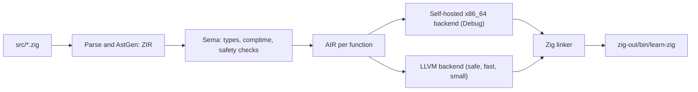

The diagram is the pipeline behind `zig build`. Source is parsed into ZIR (an untyped intermediate form), semantic analysis (Sema) assigns types and runs every `comptime` expression, and each function becomes AIR. In Debug mode on x86_64 Linux and macOS, AIR goes to Zig's own backend, which compiles several times faster than LLVM. Release modes go through LLVM for its optimiser.

### 1.1 What Zig Is and the Problem It Solves

Zig is a general-purpose systems language and a toolchain. It targets the same space as C: operating systems, embedded firmware, game engines, databases, language runtimes, and any program where you need control over memory and the produced machine code. It tries to fix C's sharp edges without adding a runtime, a garbage collector or a borrow checker.

Its design rules show up in every later stage:

- **No hidden control flow.** There are no exceptions, no operator overloading, no implicit constructors or destructors, and no property getters. If a line does not contain a function call, it does not call one. `try` is visible at every call site that can fail.
- **No hidden allocations.** Nothing in the language allocates heap memory. Library functions that need memory take a `std.mem.Allocator` parameter, so the caller always chooses the strategy.
- **Compile-time execution instead of macros and templates.** The same language runs at compile time (`comptime`), so generics, reflection and code generation are ordinary Zig code.
- **Safety by default, opt-out per scope.** Integer overflow, out-of-bounds indexing, null unwraps and invalid casts are checked in Debug and `safe` builds and panic with a stack trace.
- **One toolchain.** `zig` is the compiler, build system, test runner, formatter, package manager, C/C++ compiler (`zig cc`, `zig c++`) and cross-compiler, with libc headers for many targets bundled.

| Concern | C | Zig | Rust | Go |
| --- | --- | --- | --- | --- |
| Memory management | Manual, `malloc`/`free` | Manual, explicit `Allocator` values | Ownership and borrowing, checked at compile time | Garbage collector |
| Use-after-free | Undefined, silent | Not prevented by the type system; caught at runtime by `SafeAllocator` in debug builds | Prevented at compile time | Prevented by GC |
| Generics | Macros, `void *` | `comptime` parameters and functions returning `type` | Traits and monomorphisation | Type parameters |
| Errors | Return codes, `errno` | Error unions (`!T`), `try`, error return traces | `Result<T, E>`, `?` | Multiple return values |
| Build system | Make, CMake (separate) | `build.zig`, written in Zig | Cargo | `go build` |
| Cross-compiling | Needs a cross toolchain | `-Dtarget=aarch64-linux-musl`, built in | Needs target std and a linker | `GOOS`/`GOARCH`, built in |
| Calling C | Native | Direct, through translated headers | `extern "C"` plus bindgen | cgo, with a call overhead |
| Stability | Decades | Pre-1.0, breaking changes each minor release | Stable since 2015 | Stable since 2012 |

Choose Zig when you want C-level control and C interop with better defaults and tooling, and you can absorb breaking changes until 1.0. Choose Rust when compile-time memory safety is a hard requirement. Choose Go when a garbage collector is acceptable and you value a stable language more than control over memory.

### 1.2 Installing Zig and Checking the Toolchain

Zig ships as a single archive with the compiler and the standard library source. There is no installer and nothing outside the extracted folder.

```bash
# Linux x86_64. Pick your OS and CPU from https://ziglang.org/download/
curl -fsSLO https://ziglang.org/download/0.17.0/zig-x86_64-linux-0.17.0.tar.xz
# Compare with the "shasum" for this file in https://ziglang.org/download/index.json
sha256sum zig-x86_64-linux-0.17.0.tar.xz
tar -xf zig-x86_64-linux-0.17.0.tar.xz
export PATH="$PWD/zig-x86_64-linux-0.17.0:$PATH"

zig version          # 0.17.0
zig env              # JSON: lib_dir, std_dir, global_cache_dir, target
zig targets | head   # every CPU, OS and ABI this compiler can emit code for
```

On macOS, `brew install zig` and on Windows `winget install zig.zig` also work, but package managers can lag behind the release or ship a development build. Check `zig version` after installing, and pin the version in CI (this repo uses `mlugg/setup-zig` with `version: 0.17.0`).

Editor support comes from ZLS, the Zig language server. Its version must match the compiler's minor version, so install ZLS 0.17.x for Zig 0.17.x. A ZLS built for a different minor version gives wrong diagnostics or none at all.

Since `zig env` prints the standard library path, you can read the source of any std function you call. That is the most reliable documentation for a pre-1.0 language; this guide was checked against it.

### 1.3 Project Anatomy

`zig init` creates a project with a library module and an executable. This repo follows the same layout:

```text
learn-zig/
├── build.zig          build graph, written in Zig
├── build.zig.zon      package manifest: name, version, fingerprint, dependencies
├── src/
│   ├── main.zig       executable entry point: the HTTP server
│   ├── root.zig       library root: re-exports the modules below
│   ├── text.zig       word statistics (allocators, hash maps, sorting)
│   ├── ring.zig       comptime-generic ring buffer
│   ├── config.zig     PORT parsing with error sets
│   ├── router.zig     socket-free request routing
│   └── roadmap.zig    the guide's stages as data
├── examples/          every README sample, run as tests
├── zig-out/           install prefix for build output (git-ignored)
└── .zig-cache/        local build cache (git-ignored)
```

The manifest is a ZON file (Zig Object Notation, a subset of Zig syntax for data):

```zig
.{
    .name = .learn_zig,
    .version = "1.0.0",
    .fingerprint = 0x249d3c1103c793dd, // Changing this has security and trust implications.
    .minimum_zig_version = "0.17.0",
    .dependencies = .{},
    .paths = .{
        "build.zig",
        "build.zig.zon",
        "src",
        "examples",
        "LICENSE",
        "README.md",
    },
}
```

| Field | Role | What happens at runtime |
| :--- | :--- | :--- |
| `.name = .learn_zig` | Package name, an enum literal, so it must be a valid identifier | Used as the default import name when another package depends on this one |
| `.version` | Semantic version of the package | Informational; dependencies are pinned by hash, not version |
| `.fingerprint` | Random 64-bit identity of the package, generated once | Lets the package manager tell a fork from the original; `zig build` refuses to run without it and suggests a value |
| `.minimum_zig_version` | Oldest compiler that can build the package | Older compilers fail with a clear message instead of confusing errors |
| `.dependencies` | URL plus content hash per dependency | Filled in by `zig fetch --save <url>` (Stage 2.8) |
| `.paths` | Files that make up the package when someone else fetches it | Files outside these paths are excluded from the package hash |

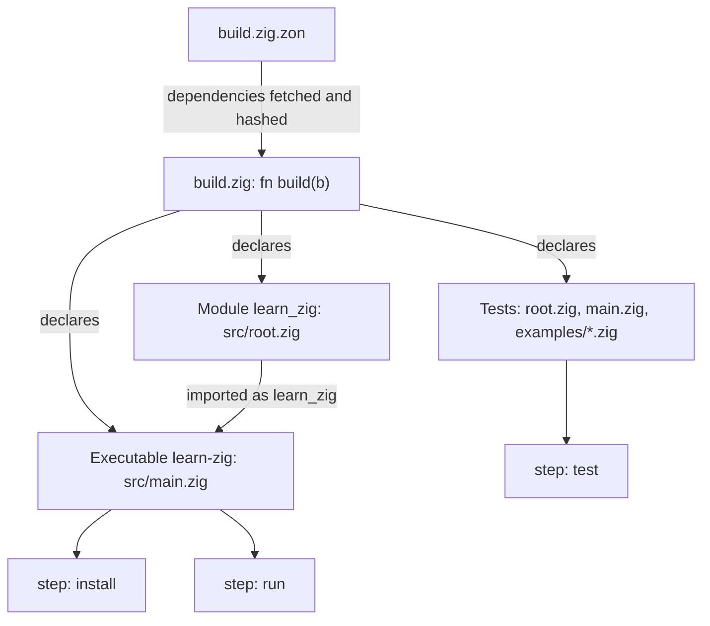

`build.zig` does not compile anything itself. Its `build` function declares a graph of steps; the build runner then executes the steps you ask for on the command line, in parallel and with caching.

```zig
const std = @import("std");

pub fn build(b: *std.Build) void {
    const target = b.standardTargetOptions(.{});
    const optimize = b.standardOptimizeOption(.{});

    // Library module: everything that can be tested without a socket.
    const lib_mod = b.addModule("learn_zig", .{
        .root_source_file = b.path("src/root.zig"),
        .target = target,
        .optimize = optimize,
    });

    // The server executable imports the library module by name.
    const exe = b.addExecutable(.{
        .name = "learn-zig",
        .root_module = b.createModule(.{
            .root_source_file = b.path("src/main.zig"),
            .target = target,
            .optimize = optimize,
            .imports = &.{
                .{ .name = "learn_zig", .module = lib_mod },
            },
        }),
    });
    b.installArtifact(exe);

    const run_cmd = b.addRunArtifact(exe);
    run_cmd.step.dependOn(b.getInstallStep());
    run_cmd.addPassthruArgs();
    const run_step = b.step("run", "Run the HTTP server");
    run_step.dependOn(&run_cmd.step);

    const lib_tests = b.addTest(.{ .root_module = lib_mod });
    const exe_tests = b.addTest(.{ .root_module = exe.root_module });
    const test_step = b.step("test", "Run unit tests");
    test_step.dependOn(&b.addRunArtifact(lib_tests).step);
    test_step.dependOn(&b.addRunArtifact(exe_tests).step);
}
```

| Line / API | Role | What happens at runtime |
| :--- | :--- | :--- |
| `b.standardTargetOptions(.{})` | Adds `-Dtarget=` | Defaults to the host; any value from `zig targets` cross-compiles |
| `b.standardOptimizeOption(.{})` | Adds `-Doptimize=` | `debug` (default), `safe`, `fast` or `small` |
| `b.addModule("learn_zig", ...)` | Declares a public module | Other packages can import it as `learn_zig` after depending on this package |
| `b.createModule(...)` | Declares a private module | Used as the executable's root; not visible to dependents |
| `.imports = &.{ ... }` | Wires module names | Inside `main.zig`, `@import("learn_zig")` resolves to `src/root.zig` |
| `b.installArtifact(exe)` | Hooks the exe into the default `install` step | `zig build` copies the binary to `zig-out/bin/` |
| `run_cmd.addPassthruArgs()` | Forwards arguments | `zig build run -- --flag` passes `--flag` to the program |
| `b.addTest(.{ .root_module = ... })` | Compiles a test binary | Contains every `test` block reachable from that module |
| `b.step("test", ...)` | Names a top-level step | Shows up in `zig build --help` and runs with `zig build test` |

The repo's real `build.zig` also adds an `examples` step that compiles each file in `examples/` as its own test binary.

### 1.4 Walking Through the Starter Project

The starter is a small HTTP service that computes word statistics. It is deliberately single-threaded so Stages 1-3 can focus on the language; Stage 4 makes it concurrent.

```bash
zig build run                       # listens on 0.0.0.0:8080 (PORT overrides it)
curl -s localhost:8080/health
# {"status":"ok","requests":1}
curl -s -X POST --data-binary 'The quick fox. The lazy dog. the end' 'localhost:8080/stats?top=2'
# {"bytes":36,"lines":1,"words":8,"unique":6,"top":[{"word":"the","count":3},{"word":"dog","count":1}]}
curl -s localhost:8080/history
# [{"words":8,"unique":6,"top_word":"the"}]
```

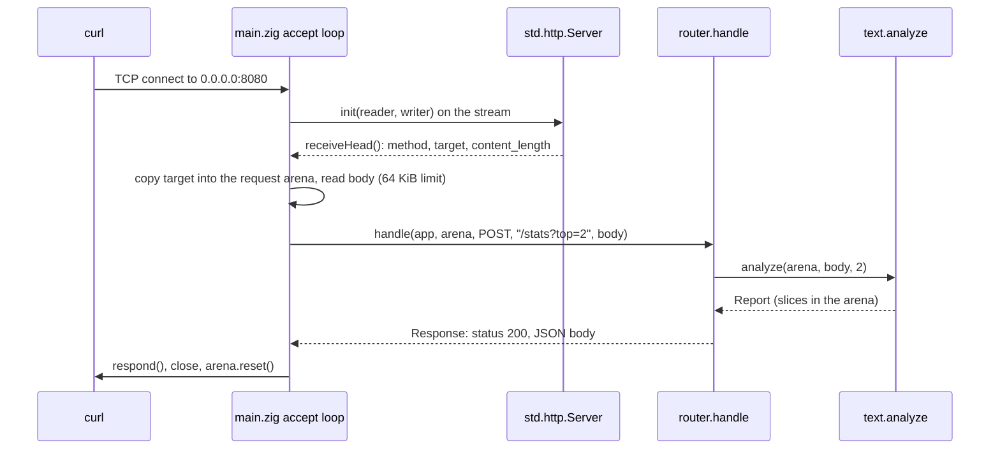

Here is `src/main.zig` in full:

```zig
const std = @import("std");
const Io = std.Io;
const learn_zig = @import("learn_zig");
const router = learn_zig.router;

pub fn main(init: std.process.Init) !void {
    const io = init.io;
    const gpa = init.gpa;

    const port = learn_zig.config.parsePort(init.environ_map.get("PORT")) catch |err| {
        std.log.err("PORT is not a valid TCP port: {t}", .{err});
        return err;
    };

    // 0.0.0.0, not 127.0.0.1: inside a container, loopback is unreachable
    // from the host.
    const address: Io.net.IpAddress = .{ .ip4 = .unspecified(port) };
    var server = try address.listen(io, .{ .reuse_address = true });
    defer server.deinit(io);
    std.log.info("listening on http://0.0.0.0:{d}", .{port});

    var app: router.App = .{};
    var arena_state: std.heap.ArenaAllocator = .init(gpa);
    defer arena_state.deinit();

    while (true) {
        const stream = server.accept(io) catch |err| {
            std.log.warn("accept failed: {t}", .{err});
            continue;
        };
        // One arena per request: everything the handler allocates is freed
        // by a single reset, and the capacity is reused next time.
        defer _ = arena_state.reset(.retain_capacity);
        defer stream.close(io);
        serve(io, arena_state.allocator(), &app, stream) catch |err| {
            std.log.warn("request failed: {t}", .{err});
        };
    }
}

fn serve(io: Io, arena: std.mem.Allocator, app: *router.App, stream: Io.net.Stream) !void {
    var recv_buffer: [8 * 1024]u8 = undefined;
    var send_buffer: [8 * 1024]u8 = undefined;
    var stream_reader = stream.reader(io, &recv_buffer);
    var stream_writer = stream.writer(io, &send_buffer);
    var http: std.http.Server = .init(&stream_reader.interface, &stream_writer.interface);

    var request = try http.receiveHead();

    // `head` points into the receive buffer, which reading the body reuses.
    // Copy what we need first.
    const method = request.head.method;
    const target = try arena.dupe(u8, request.head.target);

    if (request.head.content_length) |len| {
        if (len > learn_zig.text.max_input_len) {
            return request.respond("{\"error\":\"body exceeds 64 KiB\"}", .{
                .status = .payload_too_large,
                .keep_alive = false,
            });
        }
    }

    var body: []const u8 = "";
    if (method.requestHasBody()) {
        var body_buffer: [4096]u8 = undefined;
        const body_reader = request.readerExpectNone(&body_buffer);
        body = try body_reader.allocRemaining(arena, .limited(learn_zig.text.max_input_len));
    }

    const res = try router.handle(app, arena, method, target, body);
    std.log.info("{t} {s} -> {d}", .{ method, target, @backingInt(res.status) });
    try request.respond(res.body, .{
        .status = res.status,
        .keep_alive = false,
        .extra_headers = &.{.{ .name = "content-type", .value = res.content_type }},
    });
}
```

| Line / API | Role | What happens at runtime |
| :--- | :--- | :--- |
| `pub fn main(init: std.process.Init) !void` | "Juicy Main" entry point | The start code builds a general purpose allocator, an arena, an `Io` implementation and the environment map before calling `main` |
| `init.gpa` | General purpose allocator | A `SafeAllocator` in debug and safe builds (leak reports at exit); `smp_allocator` or `c_allocator` in fast and small builds |
| `init.io` | The `std.Io` instance | An `Io.Threaded`; every call that can block (accept, read, write) takes it |
| `init.environ_map.get("PORT")` | Read an environment variable | Returns `?[]const u8`; there is no global `getenv` |
| `catch \|err\| { ...; return err; }` | Handle and re-raise | Logs, then returns the error from `main`, which prints an error return trace and exits with status 1 |
| `{t}` | Format specifier | Prints the name of an error or enum tag |
| `.{ .ip4 = .unspecified(port) }` | Tagged union literal plus decl literal | Builds `IpAddress.ip4` with address 0.0.0.0 |
| `address.listen(io, .{ .reuse_address = true })` | `socket` + `bind` + `listen` | `SO_REUSEADDR` lets a restarted server bind while old sockets are in `TIME_WAIT` |
| `defer server.deinit(io)` | Scheduled cleanup | Closes the listening socket when `main` returns, on success or error |
| `var app: router.App = .{}` | State on `main`'s stack | All fields use their defaults; no heap allocation |
| `defer _ = arena_state.reset(.retain_capacity)` | Per-iteration cleanup | Frees every request allocation at once and keeps the pages for the next request |
| `stream.reader(io, &recv_buffer)` | Buffered socket reader | The buffer is caller-owned stack memory; the `interface` field is a `*std.Io.Reader` |
| `http.receiveHead()` | Parse the request line and headers | Reads until `\r\n\r\n`; fails with `HttpHeadersOversize` if they exceed the 8 KiB buffer |
| `arena.dupe(u8, request.head.target)` | Copy a slice | Needed because reading the body overwrites the buffer `target` points into |
| `allocRemaining(arena, .limited(...))` | Read the whole body | Returns `error.StreamTooLong` instead of allocating without bound |
| `@backingInt(res.status)` | Enum to integer | `std.http.Status` is an `enum(u10)`, so this yields 200, 404 and so on |

Run the tests to see the rest of the project exercised:

```bash
zig build test --summary all
# Build Summary: 15/15 steps succeeded; 54/54 tests passed
```

### 1.5 The Everyday Commands

| Command | What it does | When to use it |
| --- | --- | --- |
| `zig init` | Creates `build.zig`, `build.zig.zon`, `src/main.zig`, `src/root.zig` | Starting a project |
| `zig build` | Runs the default `install` step | Produces `zig-out/bin/<name>` |
| `zig build run -- args` | Builds, then runs with arguments | Day-to-day development |
| `zig build test --summary all` | Builds and runs every test binary, prints a tree of steps | Before every commit, and in CI |
| `zig build --watch` | Rebuilds when source files change | Tight edit loop |
| `zig build -Doptimize=safe` | Optimised build with safety checks kept | Production default for most services |
| `zig build -Dtarget=aarch64-linux-musl` | Cross-compiles | Shipping to another CPU or OS |
| `zig build --help` | Lists steps and `-D` options of this project | Discovering a project |
| `zig run file.zig` | Compiles and runs one file, no `build.zig` needed | Experiments |
| `zig test file.zig` | Compiles and runs the tests in one file | Running a single example from `examples/` |
| `zig test file.zig --test-filter "hash"` | Runs only tests whose name contains `hash` | Narrowing a failure |
| `zig fmt src build.zig` | Formats in place; also applies mechanical upgrades | On save, and after a compiler upgrade |
| `zig fmt --check .` | Fails if anything is unformatted | CI |
| `zig ast-check file.zig` | Reports syntax and AstGen errors without full analysis | Fast feedback on a broken file |
| `zig fetch --save <url>` | Downloads a package and records its hash | Adding a dependency |
| `zig env` | Prints paths and the host target as JSON | Finding the std source |

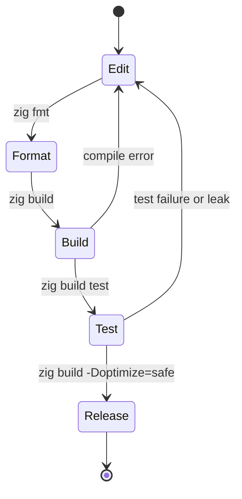

Zig caches by content hash in `.zig-cache/` (per project) and in the global cache from `zig env`. A rebuild with no changes takes milliseconds. If the cache is ever corrupted, delete `.zig-cache/` and `zig-out/`; never commit either.

### 1.6 Values, Variables and Primitive Types

Every declaration is `const` (cannot be reassigned) or `var` (can be). The compiler rejects a `var` that is never mutated and any local that is never used, so unused code does not accumulate.

```zig
test "const, var and type inference" {
    const answer = 42; // comptime_int: no fixed size until it meets a typed context
    const small: u8 = answer; // fits, so the coercion is allowed
    var counter: u32 = 0; // `var` must be mutated, or the compiler rejects it
    counter += small;
    try testing.expectEqual(42, counter);
    try testing.expect(@TypeOf(answer) == comptime_int);
}

test "arbitrary-width integers" {
    const nibble: u4 = 15; // 0..15
    const tiny: i3 = -4; // -4..3
    try testing.expectEqual(15, nibble);
    try testing.expectEqual(-4, tiny);
    try testing.expectEqual(1, @sizeOf(u4)); // stored in a whole byte
    try testing.expectEqual(4, @bitSizeOf(u4));
}
```

| Type | Meaning | Notes |
| --- | --- | --- |
| `u8`, `i32`, `u64`, `u7`, `i3`... | Unsigned or signed integer of any width from 0 to 65535 bits | Odd widths are useful in packed structs and for ranges such as a percentage in `u7` |
| `usize`, `isize` | Pointer-sized integers | Lengths and indexes are `usize` |
| `c_int`, `c_long`... | Integers with the C ABI size for the target | Use only at C boundaries |
| `f16`, `f32`, `f64`, `f80`, `f128` | IEEE floats | `f80` is the x87 extended type |
| `bool` | `true` or `false` | Not an integer; convert with `@intFromBool` |
| `void` | Zero-size type; its only value is `{}` | `HashMap(K, void)` is a set |
| `noreturn` | Type of expressions that never finish | `return`, `unreachable`, `@panic`, an endless `while (true)` |
| `comptime_int`, `comptime_float` | Arbitrary-precision literals | Exist only at compile time; coerce to a sized type when used at runtime |
| `type` | Types are values at compile time | Basis of generics in Stage 3 |
| `anyopaque` | Unknown-type memory, like C `void` | Used behind `*anyopaque` |

`undefined` means "this memory has no meaningful value yet". In Debug builds the compiler fills it with `0xaa` bytes so reading it before writing is obvious in a debugger; in release builds it is left as whatever was there. It is the right way to declare a buffer you are about to fill, as `main.zig` does with `var recv_buffer: [8 * 1024]u8 = undefined;`.

Identifiers that clash with keywords or contain unusual characters are written as `@"name"`. The router uses `.{ .@"error" = message }` to produce a JSON field called `error`.

### 1.7 Integer Semantics: Overflow and Casting

Plain arithmetic operators assert that the result fits. When it does not, Debug and `safe` builds panic, and `fast`/`small` builds treat it as illegal behavior that the optimiser may assume never happens. If you want wrapping or saturation, say so with a different operator.

```zig
test "overflow is explicit: wrapping, saturating and checked" {
    const max: u8 = 255;
    try testing.expectEqual(0, max +% 1); // wrapping add
    try testing.expectEqual(255, max +| 1); // saturating add
    // Checked add returns a tuple { result, overflow_bit }.
    const sum, const overflowed = @addWithOverflow(max, 1);
    try testing.expectEqual(0, sum);
    try testing.expectEqual(1, overflowed);
    // `max + 1` with runtime values panics in debug/safe builds:
    // "panic: integer overflow".
}
```

| Operator | Behaviour on overflow | Typical use |
| --- | --- | --- |
| `+ - * /` | Panic in Debug/`safe`; illegal behavior in `fast`/`small` | Default for counts and sizes, where overflow is a bug |
| `+% -% *%` | Wraps modulo 2^n | Hashes (`h *%= 16777619` in FNV-1a), checksums, sequence numbers |
| `+\| -\| *\| <<\|` | Clamps to the type's min or max | Rate counters, audio samples, `clampAdd` in Stage 2 |
| `@addWithOverflow` and friends | Returns the wrapped result and an overflow bit | Big-integer arithmetic, parsing |
| `std.math.add(T, a, b)` | Returns `error.Overflow` | When overflow is an expected, recoverable input condition |

Conversions between numeric types are never silent when they can lose information:

```zig
test "casting is always spelled out" {
    const big: u32 = 300;
    const narrowed: u8 = @truncate(big); // keep the low 8 bits: 300 - 256 = 44
    try testing.expectEqual(44, narrowed);

    const fits: u32 = 200;
    const checked: u8 = @intCast(fits); // safety-checked: panics if it does not fit
    try testing.expectEqual(200, checked);

    const f: f64 = @floatFromInt(checked);
    try testing.expectEqual(200.0, f);
    const back: i32 = @intFromFloat(@trunc(12.9));
    try testing.expectEqual(12, back);

    // @as performs only coercions that can never lose information.
    try testing.expectEqual(@as(u64, 7), @as(u64, @as(u8, 7)));
}
```

Cast builtins infer their destination from the result location: `const x: u8 = @intCast(y)` knows to produce a `u8`. When there is no result location, wrap it: `@as(u8, @intCast(y))`. Widening (`u8` to `u32`, `u32` to `i64`) needs no cast at all, because every value fits.

`config.zig` combines these ideas. It parses into a wider `u32` so that "70000" can be reported as out of range rather than as not a number, then narrows with `@intCast` after the range check has proven it safe:

```zig
pub fn parsePort(raw: ?[]const u8) PortError!u16 {
    const text = std.mem.trim(u8, raw orelse return default_port, " \t\r\n");
    if (text.len == 0) return default_port;
    // Parse into a wider type so 70000 reports PortOutOfRange, not InvalidPort.
    const value = std.fmt.parseInt(u32, text, 10) catch return error.InvalidPort;
    if (value == 0 or value > std.math.maxInt(u16)) return error.PortOutOfRange;
    return @intCast(value);
}
```

### 1.8 Arrays, Slices and Strings

An array `[N]T` has its length in the type and is a value: assigning it copies all N elements. A slice `[]T` is a pointer plus a runtime length, two machine words, and it never owns memory. Most functions take slices so they work with arrays, heap buffers and sub-ranges alike.

```zig
test "arrays have a comptime length, slices a runtime one" {
    const primes = [_]u32{ 2, 3, 5, 7, 11 }; // [5]u32, length inferred
    const zeroes: [4]u8 = @splat(0); // every element set to 0
    try testing.expectEqual(5, primes.len);
    try testing.expectEqualSlices(u8, &.{ 0, 0, 0, 0 }, &zeroes);

    const middle: []const u32 = primes[1..4]; // pointer + length, no copy
    try testing.expectEqualSlices(u32, &.{ 3, 5, 7 }, middle);

    // Slicing with comptime-known bounds produces a pointer to an array.
    const first_two = primes[0..2];
    try testing.expect(@TypeOf(first_two) == *const [2]u32);
}
```

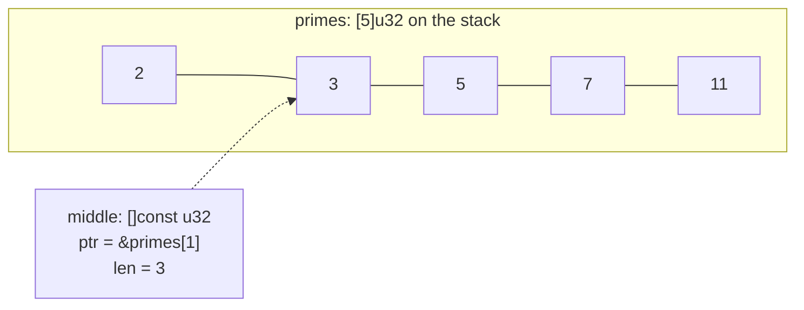

Zig has no separate string type. A string is a slice of bytes, `[]const u8`, conventionally UTF-8. A string literal is a pointer to a null-terminated constant array, which coerces to a slice or to a C string:

```zig
test "strings are byte slices" {
    const literal = "zig"; // *const [3:0]u8: pointer to a null-terminated array
    try testing.expect(@TypeOf(literal) == *const [3:0]u8);
    const as_slice: []const u8 = literal; // coerces to a slice
    try testing.expectEqual(3, as_slice.len);
    try testing.expectEqual(0, literal[3]); // the sentinel is readable

    const joined = "hello, " ++ "world"; // ++ concatenates at compile time
    try testing.expectEqualStrings("hello, world", joined);
    try testing.expect(std.mem.eql(u8, "abc", "abc")); // == compares pointers, not bytes
}

test "multiline string literals" {
    const banner =
        \\GET /health HTTP/1.1
        \\Host: localhost
    ;
    try testing.expectEqual(2, std.mem.count(u8, banner, "\n") + 1);
}
```

| Type | Read as | Length known | Typical source |
| --- | --- | --- | --- |
| `[5]u8` | Array of 5 bytes | Compile time, in the type | Local buffers, struct fields |
| `*const [5:0]u8` | Pointer to 5 bytes followed by a 0 | Compile time | String literals |
| `[]const u8` | Slice of bytes | Runtime, in the slice | Function parameters, most std APIs |
| `[:0]const u8` | Slice whose element after the end is 0 | Runtime | Strings passed to C, file paths for some OS calls |
| `[*:0]const u8` | Many-item pointer to a 0-terminated run | Not stored; found by scanning | C `const char *` |

The words of an analysed body come from `text.zig`'s iterator, which only slices the input and never copies it:

```zig
pub const WordIterator = struct {
    input: []const u8,
    index: usize = 0,

    pub fn next(it: *WordIterator) ?[]const u8 {
        // Skip separators.
        while (it.index < it.input.len and !isWordByte(it.input[it.index])) : (it.index += 1) {}
        if (it.index == it.input.len) return null;
        const start = it.index;
        while (it.index < it.input.len and isWordByte(it.input[it.index])) : (it.index += 1) {}
        return it.input[start..it.index];
    }
};
```

### 1.9 Optionals

`?T` is either a `T` or `null`. Only optional types can be null, so a plain `*T` or `[]const u8` is always valid to use. For pointers, `?*T` has the same size as `*T` because address 0 represents null.

```zig
fn findIndex(haystack: []const u32, needle: u32) ?usize {
    for (haystack, 0..) |value, i| {
        if (value == needle) return i;
    }
    return null;
}

test "optionals replace null pointers and sentinel return values" {
    const xs = [_]u32{ 4, 8, 15, 16 };
    try testing.expectEqual(2, findIndex(&xs, 15).?); // .? asserts non-null
    try testing.expectEqual(null, findIndex(&xs, 99));

    const fallback = findIndex(&xs, 99) orelse xs.len;
    try testing.expectEqual(4, fallback);

    if (findIndex(&xs, 16)) |i| {
        try testing.expectEqual(3, i); // `i` is the unwrapped usize
    } else unreachable;
}
```

| Form | Meaning | Use it when |
| --- | --- | --- |
| `x orelse default` | Value of `x`, or `default` if null | A sensible fallback exists |
| `x orelse return error.Missing` | Early exit; `orelse` accepts any `noreturn` expression | Null means the input is invalid |
| `if (x) \|v\| { ... } else { ... }` | Branch with the unwrapped value | Both cases need code |
| `while (it.next()) \|v\| { ... }` | Loop until null | Iterators (Stage 2.5) |
| `x.?` | Unwrap, panic in safe builds if null | You have proven it is not null |

`config.parsePort(init.environ_map.get("PORT"))` shows the idea at an API boundary: the map returns `?[]const u8`, and `parsePort` turns a missing value into the default with `raw orelse return default_port`.

### 1.10 Control Flow as Expressions

`if`, `switch`, blocks and loops can all produce values, which removes most temporary variables and ternary operators.

```zig
test "if, while and for are expressions or take captures" {
    const n: u32 = 7;
    const parity = if (n % 2 == 0) "even" else "odd";
    try testing.expectEqualStrings("odd", parity);

    var i: u32 = 0;
    var sum: u32 = 0;
    while (i < 5) : (i += 1) sum += i; // continue expression runs every iteration
    try testing.expectEqual(10, sum);

    var total: usize = 0;
    for (0..4) |k| total += k; // ranges are half-open
    try testing.expectEqual(6, total);

    const a = [_]u8{ 1, 2, 3 };
    const b = [_]u8{ 10, 20, 30 };
    var dot: u32 = 0;
    for (a, b) |x, y| dot += @as(u32, x) * y; // lengths must match (safety-checked)
    try testing.expectEqual(140, dot);
}

test "labeled blocks and loops" {
    const grid = [_][3]u8{ .{ 1, 2, 3 }, .{ 4, 5, 6 } };
    const found = outer: for (grid, 0..) |row, r| {
        for (row, 0..) |cell, c| {
            if (cell == 5) break :outer .{ r, c };
        }
    } else null;
    try testing.expectEqual(1, found.?[0]);
    try testing.expectEqual(1, found.?[1]);

    const clamped = blk: {
        const raw: i32 = -12;
        if (raw < 0) break :blk 0;
        break :blk raw;
    };
    try testing.expectEqual(0, clamped);
}

test "switch is exhaustive and returns a value" {
    const code: u16 = 404;
    const class = switch (code) {
        200...299 => "success",
        300...399 => "redirect",
        400, 404, 410 => "client error",
        500...599 => "server error",
        else => "other",
    };
    try testing.expectEqualStrings("client error", class);
}
```

| Construct | Detail worth knowing |
| --- | --- |
| `for (a, b) \|x, y\|` | Iterates several sequences in lockstep; unequal lengths panic in safe builds |
| `for (items, 0..) \|item, i\|` | The `0..` range supplies the index |
| `for (&array) \|*slot\|` | Iterate by pointer to modify elements in place |
| `while (cond) : (step)` | The continue expression runs after each iteration, including after `continue` |
| `loop: for ... break :loop value` | `break` out of an outer loop with a value; the loop's `else` runs if it finishes without `break` |
| `blk: { ... break :blk v; }` | A block that computes a value, used for `top_n` in `router.zig` |
| `switch` with `a...b` | Inclusive ranges; the compiler rejects overlapping or missing cases |

There is no `goto` and no fallthrough between `switch` prongs. The labeled `switch` with `continue :sw next_state` (added in 0.14) builds state machines; it appears in Stage 5 when parsing a protocol.

### 1.11 Pitfalls

| Pitfall | Symptom | Fix |
| --- | --- | --- |
| Declaring a local with `var` that is never reassigned | `error: local variable is never mutated` with `note: consider using 'const'` | Use `const`. For a `var` you only pass by pointer later, the compiler still sees the mutation through `&x` |
| Leaving a local unused while sketching code | `error: unused local constant` | Delete it, or write `_ = x;` while work is in progress |
| Ignoring a function's error union | `error: error union of type '...!void' is ignored` with `note: consider using 'try', 'catch', or 'if'` | Add `try`, handle it with `catch`, or discard explicitly with `catch {}` only if failure truly does not matter |
| Comparing strings with `==` | `error: cannot compare strings with ==` | `std.mem.eql(u8, a, b)` |
| Assigning a wider runtime integer to a narrower one | `error: expected type 'u8', found 'u32'` with `unsigned 8-bit int cannot represent all possible unsigned 32-bit values` | `@intCast` after a range check, or `@truncate` if dropping bits is intended |
| Plain `+` on a value at its maximum | `panic: integer overflow` in Debug/`safe` | `+%`, `+\|`, `@addWithOverflow` or `std.math.add`, depending on intent |
| `@intCast` of a value that does not fit | `panic: integer does not fit in destination type` | Validate first, as `parsePort` does |
| Indexing past the end | `panic: index out of bounds: index 5, len 3` | Check `i < slice.len`, or iterate with `for` instead of indexes |
| Unwrapping null with `.?` | `panic: attempt to use null value` | Use `orelse` or `if (x) \|v\|` unless you have proven non-null |
| Returning a slice of a local array | `error: returning address of expired local variable 'buf'` | Take a caller buffer or an allocator, or return the array by value |
| Following a 0.13-era tutorial | `std.io.getStdOut` or `GeneralPurposeAllocator` "has no member" errors | Check the date of the source; use this guide's versions section to translate |
| ZLS for a different minor version | Missing or wrong diagnostics in the editor | Install ZLS whose version matches `zig version` |

### 1.12 Best Practices

- **Default to `const`**: the compiler enforces it for locals, and it documents intent for globals and fields.
- **Pin the compiler**: set `minimum_zig_version` and pin the version in CI, because each minor release breaks code.
- **Take slices, not arrays, as parameters**: `[]const T` accepts arrays, heap buffers and sub-ranges without copies.
- **Pick the arithmetic operator by meaning**: plain operators for values that must not overflow, `%` and `|` variants for hashes and counters.
- **Validate before `@intCast` and `.?`**: they are assertions, and in `fast` builds a failed assertion is undefined behaviour, not a panic.
- **Run `zig fmt` on save and `zig fmt --check` in CI**: formatting debates disappear, and `zig fmt` also performs automatic upgrades between versions.
- **Read the standard library source when the docs are thin**: `zig env` shows where it is, and it is written in plain Zig.
- **Keep `.zig-cache/` and `zig-out/` out of git**: they are machine-specific and rebuilt on demand.

### 1.13 Hands-on Exercise

Add a `GET /version` route to the starter that returns `{"zig":"0.17.0","app":"1.0.0"}`.

1. In `src/router.zig`, add `version` to the `Route` enum and `.{ "/version", .version }` to the `routes` table.
2. Handle it in the `switch` in `handle`. Get the compiler version from `@import("builtin").zig_version_string` and hard-code the app version for now.
3. Add a test next to the existing ones that calls `call(&app, &arena, .GET, "/version", "")` and checks the status and body.

Expected result:

```bash
zig build test --summary all   # one more test passes
zig build run &
curl -s localhost:8080/version
# {"zig":"0.17.0","app":"1.0.0"}
```

If you forget step 2, the build fails with `error: switch must handle all possibilities` and a note naming `version`; exhaustive switches turn a forgotten case into a compile error. Compare your solution with the existing `/roadmap` handler in [`src/router.zig`](src/router.zig).

[Back to top ⤴️](#-table-of-contents)

---

## 2. Stage 2: Functions, Data Structures & Modules

This stage moves from single values to program structure: functions, structs with methods, enums and tagged unions, the standard containers, iterators, formatted output, and how files, modules and packages fit together. It assumes Stage 1. Afterwards you can model a domain with types, store it in `ArrayList` and hash maps, and split a project into modules and packages.

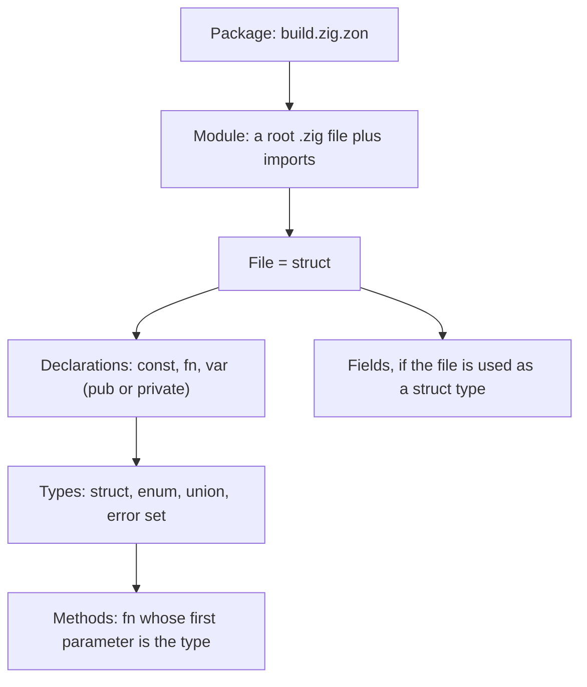

### 2.1 Functions and Parameters

Parameters are immutable. The compiler decides whether to pass a parameter by copy or by reference, so passing a large struct by value is cheap, but you cannot mutate it; take `*T` when the function must modify its argument. There is no overloading and no default arguments; use an options struct instead (`.{ .reuse_address = true }` in Stage 1 is one).

```zig
/// Parameters are immutable. Small values are copied; large ones may be
/// passed by reference behind the scenes, so never rely on either.
fn clampAdd(a: u8, b: u8, limit: u8) u8 {
    return @min(a +| b, limit);
}

/// `anytype` makes the function generic over its argument type. Each distinct
/// type gets its own compiled instance.
fn sumAll(values: anytype) u64 {
    var total: u64 = 0;
    for (values) |v| total += v;
    return total;
}

test "functions" {
    try testing.expectEqual(100, clampAdd(90, 30, 100));
    try testing.expectEqual(6, sumAll([_]u8{ 1, 2, 3 }));
    try testing.expectEqual(10, sumAll(&[_]u32{ 4, 6 }));
}
```

| Feature | Syntax | Notes |
| --- | --- | --- |
| Visibility | `pub fn` | Without `pub`, a function is private to its file |
| Error-returning | `fn f() !T` or `fn f() MyError!T` | Inferred or explicit error sets (Stage 3.5) |
| Generic by duck typing | `fn f(x: anytype)` | The body is checked per call-site type; errors appear where a type lacks a needed operation |
| Generic by explicit type | `fn f(comptime T: type, x: T)` | Clearer errors and documentation; preferred for public APIs |
| Forced inlining | `inline fn` | Semantic, not a hint: the call is always inlined, and comptime-known arguments stay comptime-known |
| Function pointers | `*const fn (u8) bool` | Used for callbacks and vtables such as `Allocator` |
| Calling convention | `fn f() callconv(.c) void` | Needed for functions C code calls (Stage 6.3) |

`anytype` is convenient for internal helpers, but its errors point inside the function body. Public APIs usually spell out `comptime T: type` or a concrete type so the signature documents what callers must pass.

### 2.2 Structs, Methods and Decl Literals

A struct is a type with fields and declarations. Declarations inside it (`const`, `fn`, `var`) live in its namespace, and a function whose first parameter is the struct (or a pointer to it) can be called with method syntax.

```zig
const Vec2 = struct {
    x: f32 = 0,
    y: f32 = 0,

    /// A decl literal: `.zero` works wherever a Vec2 is expected.
    pub const zero: Vec2 = .{};

    pub fn init(x: f32, y: f32) Vec2 {
        return .{ .x = x, .y = y };
    }

    pub fn add(a: Vec2, b: Vec2) Vec2 {
        return .{ .x = a.x + b.x, .y = a.y + b.y };
    }

    /// Methods that mutate take a pointer.
    pub fn scale(v: *Vec2, k: f32) void {
        v.x *= k;
        v.y *= k;
    }

    /// Called by `{f}` in format strings.
    pub fn format(v: Vec2, w: *std.Io.Writer) std.Io.Writer.Error!void {
        try w.print("({d}, {d})", .{ v.x, v.y });
    }
};

test "structs, methods and decl literals" {
    var p: Vec2 = .init(1, 2); // decl literal calling Vec2.init
    p.scale(3); // same as Vec2.scale(&p, 3)
    const q = p.add(.zero);
    try testing.expectEqual(3, q.x);

    var buf: [32]u8 = undefined;
    const s = try std.fmt.bufPrint(&buf, "{f}", .{q});
    try testing.expectEqualStrings("(3, 6)", s);
}
```

| Line / API | Role | What happens at runtime |
| :--- | :--- | :--- |
| `x: f32 = 0` | Field with a default value | `.{}` initialises every field that has a default |
| `pub const zero: Vec2 = .{};` | Constant in the struct namespace | Stored once in read-only data |
| `.init(1, 2)` with a known result type | Decl literal | The compiler looks up `init` in `Vec2` because the destination type is `Vec2` |
| `p.scale(3)` | Method call | Sugar for `Vec2.scale(&p, 3)`; the compiler takes the address because `scale` wants `*Vec2` |
| `p.add(.zero)` | Method call by value | `p` is passed as the first argument; `.zero` resolves to `Vec2.zero` |
| `fn format(v, w: *std.Io.Writer)` | Custom formatting | `{f}` calls it; there are no format options in its signature since 0.15 |

Decl literals are why so much modern Zig reads `var list: std.ArrayList(u32) = .empty;` or `var arena: std.heap.ArenaAllocator = .init(gpa);`. The pattern is: put the type on the left once, and use `.name` on the right for constants and constructors. `router.App` in the starter is a struct whose fields all have defaults, so `var app: router.App = .{};` creates one with no constructor at all.

Zig has no constructors or destructors. By convention a type offers `init` (or `.empty` for a constant initial value) and `deinit`, and the caller writes `defer x.deinit(...)` right after creating it.

### 2.3 Enums, Tagged Unions and Switch

An enum is a set of named values with an integer tag. A tagged union stores one of several payloads plus an enum saying which one is active. `switch` over either must handle every case, which is what makes them safe to extend.

```zig
const Method = enum {
    get,
    post,
    delete,

    pub fn isSafe(m: Method) bool {
        return switch (m) {
            .get => true,
            .post, .delete => false,
        };
    }
};

const Shape = union(enum) {
    circle: f32, // radius
    rect: struct { w: f32, h: f32 },
    point,

    fn area(s: Shape) f32 {
        return switch (s) {
            .circle => |r| std.math.pi * r * r,
            .rect => |r| r.w * r.h,
            .point => 0,
        };
    }
};

test "enums and tagged unions" {
    try testing.expect(Method.get.isSafe());
    try testing.expectEqualStrings("post", @tagName(Method.post));
    try testing.expectEqual(.delete, std.meta.stringToEnum(Method, "delete").?);

    const shapes = [_]Shape{ .{ .circle = 1 }, .{ .rect = .{ .w = 2, .h = 3 } }, .point };
    var total: f32 = 0;
    for (shapes) |s| total += s.area();
    try testing.expectApproxEqAbs(9.14159, total, 0.0001);
    try testing.expectEqual(.rect, std.meta.activeTag(shapes[1]));
}
```

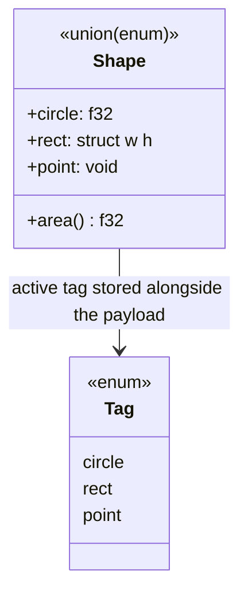

| Feature | Example | Why it matters |
| --- | --- | --- |
| Explicit tag type | `enum(u8) { a = 1, b = 2 }` | Fixed wire values for protocols and file formats |
| Non-exhaustive enum | `enum(u8) { a, b, _ }` | Accepts unknown values from the outside world; `switch` needs a `_` prong |
| Payload capture | `.circle => \|r\|` | Gives the active field; `\|*r\|` gives a pointer to modify it |
| `inline else => \|payload, tag\|` | Generates one prong per remaining case | Write generic handling once, e.g. calling the same method on every variant |
| Enum to integer | `@backingInt(e)` (0.17) | Replaces `@intFromEnum` |
| Integer to enum | `@fromBackingInt(n)` | Safety-checked: an invalid value panics in safe builds |
| Names | `@tagName(e)`, `std.meta.stringToEnum(E, s)` | Logging, parsing configuration |
| Bare union | `union { a: u32, b: f32 }` | No tag; accessing the inactive field is caught in safe builds |
| `extern union` | C-compatible layout | Interop only |

The starter's `Route` enum shows the typical server use. A request path maps to a tag, and the exhaustive `switch (route)` in `handle` guarantees every route has a handler:

```zig
const Route = enum { health, stats, history, roadmap };

/// Built at compile time: a sorted lookup table with no runtime setup.
const routes = std.StaticStringMap(Route).initComptime(.{
    .{ "/health", .health },
    .{ "/stats", .stats },
    .{ "/history", .history },
    .{ "/roadmap", .roadmap },
});
```

`std.StaticStringMap` sorts its keys by length at compile time, so a lookup only compares strings of the same length as the input. The table costs nothing at startup.

### 2.4 Standard Containers

All growable std containers are "unmanaged": they do not store an allocator. You pass the allocator to each method that may allocate, and to `deinit`. That makes the cost of each call visible and lets one container be built with an arena and read without one.

```zig
test "ArrayList takes the allocator on every call" {
    const gpa = testing.allocator;
    var list: std.ArrayList(u32) = .empty;
    defer list.deinit(gpa);

    try list.append(gpa, 1);
    try list.appendSlice(gpa, &.{ 2, 3, 4 });
    try testing.expectEqual(4, list.items.len);
    try testing.expectEqual(4, list.pop().?);
    try testing.expectEqual(3, list.last().?);

    try testing.expectEqual(1, list.orderedRemove(0)); // shifts the rest left
    try testing.expectEqual(2, list.swapRemove(0)); // moves the last item into the hole
    try testing.expectEqualSlices(u32, &.{3}, list.items);
}

test "hash maps" {
    const gpa = testing.allocator;

    var ages: std.StringHashMapUnmanaged(u8) = .empty;
    defer ages.deinit(gpa);
    try ages.put(gpa, "ada", 36);
    try ages.put(gpa, "linus", 21);
    try testing.expectEqual(36, ages.get("ada").?);
    try testing.expectEqual(null, ages.get("grace"));

    // Insertion-ordered map: iterate in the order keys were added.
    var by_id: std.array_hash_map.Auto(u32, []const u8) = .empty;
    defer by_id.deinit(gpa);
    try by_id.put(gpa, 30, "c");
    try by_id.put(gpa, 10, "a");
    try testing.expectEqualSlices(u32, &.{ 30, 10 }, by_id.keys());
}

test "MultiArrayList stores each field in its own array" {
    const gpa = testing.allocator;
    const Particle = struct { x: f32, alive: bool };
    var ps: std.MultiArrayList(Particle) = .empty;
    defer ps.deinit(gpa);
    try ps.append(gpa, .{ .x = 1, .alive = true });
    try ps.append(gpa, .{ .x = 2, .alive = false });
    const xs: []f32 = ps.items(.x); // contiguous f32s, cache friendly
    try testing.expectEqualSlices(f32, &.{ 1, 2 }, xs);
}
```

| Container | Shape | Pick it when | Watch out for |
| --- | --- | --- | --- |
| `std.ArrayList(T)` | Contiguous `items` slice plus capacity | Default sequence type | Appending can move `items`; pointers into it go stale |
| `std.StringHashMapUnmanaged(V)` | Open addressing, string keys | Lookups by name | The map stores the key slice, not a copy; the bytes must outlive the map |
| `std.AutoHashMapUnmanaged(K, V)` | Same, with an automatic hash for `K` | Integer, enum or struct keys | Slices as keys hash the pointer, so use the String variant for text |
| `std.array_hash_map.Auto(K, V)` | Keys and values in arrays, plus an index | Iteration in insertion order, or `keys()`/`values()` as slices | Removal is `swapRemove` or `orderedRemove`, like a list |
| `std.MultiArrayList(T)` | One array per field (struct of arrays) | Hot loops touching one field of many records | Getting a whole element reassembles it from the field arrays |
| `std.StaticStringMap(V)` | Built at compile time | Fixed keyword or route tables | Keys are fixed; no insertion at runtime |
| `std.PriorityQueue(T, Ctx, cmp)` | Binary heap | Schedulers, top-k | Use `.empty`, `push` and `pop` (renamed in 0.16) |
| `std.bit_set.Static(n)` | Fixed-size bit set | Flags, small sets of indexes | Renamed from `StaticBitSet` in 0.17 |

`text.analyze` in the starter puts two of these together. It counts words in a `StringHashMapUnmanaged(u32)` and then moves the entries into an `ArrayList` to sort them:

```zig
pub fn analyze(gpa: Allocator, input: []const u8, top_n: usize) AnalyzeError!Report {
    if (input.len > max_input_len) return error.InputTooLarge;

    // One lowercase copy keeps every word slice stable for the map keys.
    const lower = try std.ascii.allocLowerString(gpa, input);

    var counts: std.StringHashMapUnmanaged(u32) = .empty;
    var total: usize = 0;
    var it = words(lower);
    while (it.next()) |word| {
        total += 1;
        const entry = try counts.getOrPut(gpa, word);
        if (entry.found_existing) {
            entry.value_ptr.* += 1;
        } else {
            entry.value_ptr.* = 1;
        }
    }

    var ranked: std.ArrayList(WordCount) = .empty;
    try ranked.ensureTotalCapacityPrecise(gpa, counts.count());
    var map_it = counts.iterator();
    while (map_it.next()) |entry| {
        ranked.appendAssumeCapacity(.{ .word = entry.key_ptr.*, .count = entry.value_ptr.* });
    }
    std.mem.sort(WordCount, ranked.items, {}, moreFrequent);

    return .{
        .bytes = input.len,
        .lines = countLines(input),
        .words = total,
        .unique = counts.count(),
        .top = ranked.items[0..@min(top_n, ranked.items.len)],
    };
}
```

| Line / API | Role | What happens at runtime |
| :--- | :--- | :--- |
| `std.ascii.allocLowerString(gpa, input)` | One copy of the input, lowercased | Every word slice points into this copy, so map keys stay valid |
| `counts.getOrPut(gpa, word)` | Single hash lookup for "insert or update" | Returns pointers to the key and value slots plus `found_existing` |
| `entry.value_ptr.* += 1` | Update in place | No second lookup |
| `ensureTotalCapacityPrecise` | Reserve exactly `count()` slots | Afterwards `appendAssumeCapacity` cannot fail, so the loop has no `try` |
| `std.mem.sort(T, items, ctx, lessThan)` | Stable block sort | `moreFrequent` orders by count, then alphabetically, so output is deterministic |
| `ranked.items[0..@min(...)]` | Slice of the sorted list | No copy; the caller gets a view into arena memory |

The function never frees anything. That is intentional: it is designed to be called with an arena (Stage 3.3), and the router resets the arena after each request.

### 2.5 The Iterator Convention

Zig has no iterator interface. By convention, an iterator is a struct with a `next` method returning `?T`, and `while (it.next()) |item|` consumes it. The std splitters and tokenizers, hash map iterators and the starter's `WordIterator` all follow it.

```zig
const Countdown = struct {
    n: u32,
    fn next(c: *Countdown) ?u32 {
        if (c.n == 0) return null;
        defer c.n -= 1;
        return c.n;
    }
};

test "the iterator convention: next() returns ?T" {
    var it: Countdown = .{ .n = 3 };
    var seen: [3]u32 = undefined;
    var i: usize = 0;
    while (it.next()) |v| : (i += 1) seen[i] = v;
    try testing.expectEqualSlices(u32, &.{ 3, 2, 1 }, &seen);

    var parts = std.mem.splitScalar(u8, "a,b,,c", ',');
    try testing.expectEqualStrings("a", parts.next().?);
    try testing.expectEqualStrings("b", parts.next().?);
    try testing.expectEqualStrings("", parts.next().?); // split keeps empties
    var toks = std.mem.tokenizeScalar(u8, "a,b,,c", ',');
    _ = toks.next();
    _ = toks.next();
    try testing.expectEqualStrings("c", toks.next().?); // tokenize skips them
}
```

`defer c.n -= 1;` runs after the `return` expression is evaluated, so the function returns the old value and then decrements. This is a small, legitimate use of `defer` outside resource cleanup.

| std helper | Splits on | Empty pieces |
| --- | --- | --- |
| `std.mem.splitScalar(u8, s, ',')` | One byte | Kept |
| `std.mem.splitSequence(u8, s, "\r\n")` | A multi-byte delimiter | Kept |
| `std.mem.splitAny(u8, s, " \t")` | Any byte of a set | Kept |
| `std.mem.tokenizeScalar` / `tokenizeAny` / `tokenizeSequence` | Same as above | Skipped |
| `std.mem.cutScalar(u8, s, '=')` | First occurrence, once | Returns the two halves as an optional pair (added in 0.16) |

Use split for formats where empty fields mean something (CSV, `a=&b=1` query strings) and tokenize for whitespace-separated words.

### 2.6 Formatting and the Writer Interface

`std.Io.Writer` is a concrete struct with a buffer and a vtable, not a generic type. Anything that produces bytes (a file, a socket, a fixed buffer, a growing heap buffer) exposes a `*std.Io.Writer`, and `print` works the same on all of them.

```zig
test "formatting into a fixed buffer and into an allocating writer" {
    var buf: [64]u8 = undefined;
    var fixed: std.Io.Writer = .fixed(&buf);
    try fixed.print("{s}={d} hex={x} pad=[{d:>4}] tag={t}", .{ "n", 255, 255, 7, Method.get });
    try testing.expectEqualStrings("n=255 hex=ff pad=[   7] tag=get", fixed.buffered());

    var aw: std.Io.Writer.Allocating = .init(testing.allocator);
    defer aw.deinit();
    try aw.writer.print("{any}", .{[_]u8{ 1, 2 }});
    try testing.expectEqualStrings("{ 1, 2 }", aw.written());

    const owned = try testing.allocator.print("{d}-{d}", .{ 1, 2 });
    defer testing.allocator.free(owned);
    try testing.expectEqualStrings("1-2", owned);
}
```

| Specifier | Prints | Example |
| --- | --- | --- |
| `{d}` | Number in decimal | `{d:>4}` right-aligns in 4 columns; `{d:.2}` gives 2 decimals for floats |
| `{x}` / `{X}` | Hex, lower or upper case | Also works on byte slices |
| `{s}` | A string (`[]const u8`) | |
| `{c}` | One byte as a character | |
| `{t}` | Tag name of an enum or error | Replaces `@tagName(x)` in arguments |
| `{f}` | Calls the value's `format` method | Required since 0.15; `{}` and `{any}` print the raw fields instead |
| `{any}` | Debug representation of any value | Arrays, structs, optionals |
| `{?s}`, `{?d}` | Optional, printing `null` when empty | |
| `{b64}` | Standard base64 | |

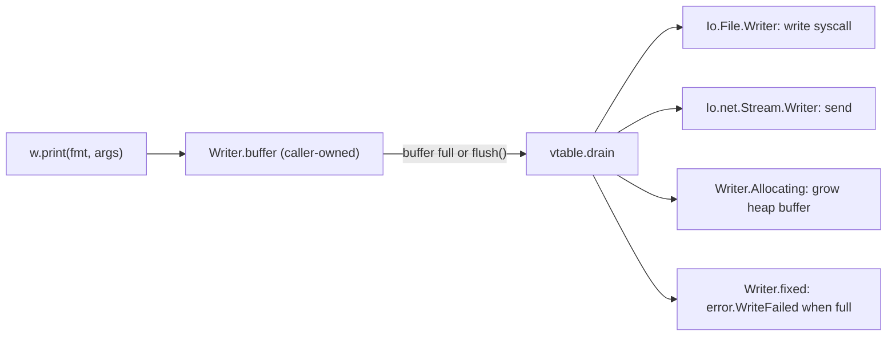

Buffering lives in the interface, so you choose the buffer size and where it lives. The cost is that you must call `flush()` before the buffer goes out of scope. `std.http.Server.Request.respond` flushes for you; when you print to stdout yourself, forgetting `flush` means the output never appears.

```zig
const std = @import("std");

pub fn main(init: std.process.Init) !void {
    var stdout_buffer: [1024]u8 = undefined;
    var stdout_writer: std.Io.File.Writer = .init(.stdout(), init.io, &stdout_buffer);
    const out = &stdout_writer.interface;

    try out.print("{d} arguments\n", .{init.minimal.args.vector.len});
    try out.flush(); // without this, nothing is written
}
```

`std.debug.print` writes unbuffered to stderr and ignores errors. Use it for debugging and quick scripts, and use a writer or `std.log` for program output.

### 2.7 Files Are Structs: Imports and Visibility

Every `.zig` file is implicitly a struct. Its top-level declarations are the struct's declarations, and its top-level fields (if it has any) make the file itself a struct type. `@import("text.zig")` returns that struct, so you access `text.analyze` exactly like a namespaced function.

```zig
//! Library root of the starter project. `main.zig` imports this module as
//! "learn_zig"; `zig build test` runs every test reachable from here.

const std = @import("std");

pub const text = @import("text.zig");
pub const ring = @import("ring.zig");
pub const config = @import("config.zig");
pub const router = @import("router.zig");
pub const roadmap = @import("roadmap.zig");

pub const RingBuffer = ring.RingBuffer;

// Checked by the compiler on every build, not by a test at runtime.
comptime {
    std.debug.assert(roadmap.STAGES.len == 7);
    for (roadmap.STAGES, 1..) |stage, n| std.debug.assert(stage.stage_number == n);
}

test {
    // Pull the tests of every imported file into `zig build test`.
    std.testing.refAllDecls(@This());
}
```

| Rule | Consequence |
| --- | --- |
| Declarations are private unless marked `pub` | `text.isWordByte` is callable from `router.zig` only because it is `pub` |
| Analysis is lazy | A function that is never referenced is not type-checked, which is why `refAllDecls` is needed to reach every file's tests |
| `@import("file.zig")` takes a path relative to the importing file | Paths cannot leave the module's root directory |
| `@import("name")` without `.zig` takes a module name | Names come from `.imports` in `build.zig`; `std` and `builtin` always exist |
| `//!` comments document the file (container); `///` document the next declaration | Both feed the generated docs (`zig build-lib -femit-docs` or the std docs) |
| `@This()` | The innermost struct type; in a file with top-level fields it names the file's own type |
| `comptime { ... }` at top level | Runs during compilation; a failed `assert` there is a compile error |

Because analysis is lazy, a typo in a function nobody calls can survive for a long time. The `test { std.testing.refAllDecls(@This()); }` block in `root.zig` references every public declaration so `zig build test` analyses, and runs the tests of, every imported file.

`usingnamespace` was removed in 0.15. To re-export something, write `pub const RingBuffer = ring.RingBuffer;`, as `root.zig` does. Explicit re-exports make it obvious where every name comes from.

### 2.8 Modules and Packages in the Build System

A **module** is a root source file plus the named imports it can see, together with its target and optimisation settings. A **package** is a directory with a `build.zig.zon`, fetched by URL and hash, which may expose modules and artifacts. A **dependency** is a package declared in your `build.zig.zon`.

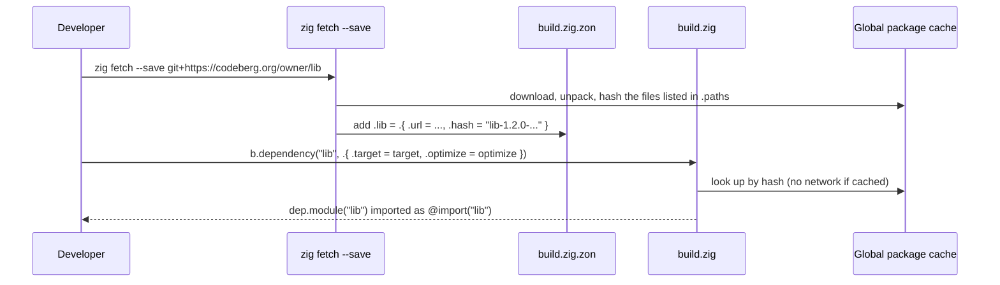

Adding a dependency takes two steps. First record it:

```bash
zig fetch --save git+https://codeberg.org/ziglang/translate-c#zig-0.17.x
# build.zig.zon gains a .translate_c entry with the URL, pinned to the
# commit the branch pointed at, and a content .hash of the fetched files.
```

Then use it in `build.zig`:

```zig
const dep = b.dependency("some_lib", .{ .target = target, .optimize = optimize });
exe.root_module.addImport("some_lib", dep.module("some_lib"));
```

| Concept | API | Notes |
| --- | --- | --- |
| Public module | `b.addModule("name", .{...})` | Visible to packages that depend on you |
| Private module | `b.createModule(.{...})` | Only for your own artifacts |
| Import wiring | `.imports = &.{ .{ .name = "x", .module = m } }` or `mod.addImport("x", m)` | The name is what `@import("x")` uses |
| Dependency | `b.dependency("name", args)` | `args` become that package's `-D` options |
| Lazy dependency | `.lazy = true` in the zon, `b.lazyDependency(...)` in build.zig | Only fetched if a step that needs it runs |
| Local override | `zig build --fork=/path/to/checkout` | Builds against a local copy of a dependency without editing the zon (0.16+) |
| Integrity | `.hash` | Content hash of the package files; a mismatch is a hard error |

The hash, not the URL, identifies a dependency. If the server returns different bytes for the same URL, the build fails instead of silently using new code. To upgrade, run `zig fetch --save` again with the new tag.

### 2.9 Pitfalls

| Pitfall | Symptom | Fix |
| --- | --- | --- |
| Storing a pointer into an `ArrayList` and then appending | Garbage values or a segfault after the list grows | Store indexes instead of pointers, reserve capacity up front with `ensureTotalCapacity`, or allocate items individually from a `std.heap.MemoryPool` so their addresses never move |
| Putting a temporary buffer's slice into a `StringHashMap` as a key | Keys change or point to freed memory; lookups fail | Make keys outlive the map: dupe them into an arena, or slice a stable buffer as `text.analyze` does |
| Using `AutoHashMap` with `[]const u8` keys | `error: std.hash.autoHash does not allow slices here ([]const u8) because the intent is unclear` | Use `StringHashMapUnmanaged` or provide a context with a byte-wise hash |
| Adding an enum value without updating every `switch` | `error: switch must handle all possibilities` and a note naming the missing value | That is the feature working: handle the new case, and avoid `else` prongs on enums you own |
| Calling a `format` method with `{}` or `{any}` | Output is the generic `.{ .x = 1 }` field dump, not your format | Use `{f}`, which is the only specifier that calls `format` |
| Printing through a buffered writer without `flush` | Program exits with no output | `try w.flush();` before the writer goes out of scope |
| Tests in imported files never run | `zig build test` passes with suspiciously few tests | Reference them: `test { std.testing.refAllDecls(@This()); }` in the root file |
| `@import("helpers")` without `.zig` for a local file | `error: no module named 'helpers' available within module '...'` | Use `@import("helpers.zig")`, or register a module of that name in `build.zig` |
| Code copied from pre-0.15 posts using `usingnamespace` | Syntax error at `usingnamespace` | Replace with explicit `pub const x = other.x;` lines |
| Old managed containers: `std.ArrayList(T).init(gpa)` | `error: struct 'array_list.Aligned(...)' has no member named 'init'` | `var list: std.ArrayList(T) = .empty;` and pass `gpa` to each call |

### 2.10 Best Practices

- **Give every type `init`/`deinit` or `.empty`, and `defer deinit` at the call site**: cleanup sits next to creation, so it is hard to forget.
- **Pass the allocator explicitly and store it only when you must**: unmanaged containers make the allocation cost of each call visible.
- **Prefer tagged unions to inheritance or "type" fields**: the compiler checks that every variant is handled.
- **Avoid `else` prongs when switching on your own enums**: an `else` hides the compile error you want when a new variant is added.
- **Keep I/O at the edges and logic in pure functions**: `router.handle` takes bytes and returns a `Response`, so it is tested without sockets.
- **Re-export a module's public surface from one root file**: `root.zig` is the single place that defines what the library offers.
- **Use `std.StaticStringMap` for fixed lookup tables**: built at compile time, no allocation, fast lookups.
- **Name modules with underscores (`learn_zig`)**: package names are enum literals and must be valid identifiers.
- **Pin dependencies by tag and let the hash enforce integrity**: never edit a `.hash` by hand.

### 2.11 Hands-on Exercise

Extend `/stats` so it also reports the **longest word**.

1. Add `longest: []const u8` to `text.Report`.
2. In `text.analyze`, track the longest word while iterating. Ties go to the word that appears first.
3. Update the expected JSON in `router.zig`'s test `POST /stats returns the report and records history` and add a test in `text.zig` for the tie rule.
4. Bonus: return the top words as a tagged union `Top = union(enum) { none, words: []const WordCount }` so that an empty body cannot be confused with "no words matched", and switch on it in the router.

Expected result for `curl -s -X POST --data-binary 'a bb ccc dd' localhost:8080/stats`:

```json
{"bytes":11,"lines":1,"words":4,"unique":4,"top":[{"word":"a","count":1},{"word":"bb","count":1},{"word":"ccc","count":1},{"word":"dd","count":1}],"longest":"ccc"}
```

`std.json.Stringify` serialises the struct fields in declaration order, so adding the field last keeps the existing tests readable. The pieces you need are all in [`src/text.zig`](src/text.zig): the `WordIterator`, the `Report` struct and the tests at the bottom of the file.

[Back to top ⤴️](#-table-of-contents)

---

## 3. Stage 3: Memory, Errors & Comptime Generics

This is the stage that makes Zig feel different from other languages. It covers where memory lives and who frees it, the `Allocator` interface and the allocators in std, `defer` and `errdefer`, error sets, every pointer type, compile-time execution, generic types and reflection, memory layout and what "illegal behavior" means in each build mode. It assumes Stages 1 and 2. Afterwards you can write generic, allocation-correct code and prove in tests that it does not leak.

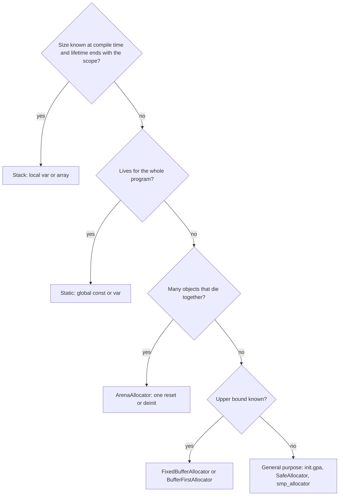

### 3.1 Where Memory Lives

Every value lives in one of three places, and Zig never moves a value from one to another without you writing the code to do it.

| Region | How you get it | Freed when | Starter example |
| --- | --- | --- | --- |
| Stack | Local `var`/`const` of a fixed-size type | The function returns | `var recv_buffer: [8 * 1024]u8 = undefined;` in `serve` |
| Static | Top-level `const`/`var`, string literals | Never (part of the binary) | `roadmap.STAGES`, the `routes` table |
| Heap | An `Allocator` call | You call `free`/`destroy`, or the arena is reset | `text.analyze`'s hash map and list, inside the request arena |

The stack is fast but limited (commonly 8 MiB for the main thread on Linux; `std.Thread.spawn` defaults to 16 MiB) and cannot outlive the function. Returning a pointer to a local is a compile error when the compiler can see it, and a dangling pointer when it cannot. The starter's `App` keeps its history in a fixed array inside the struct, so it needs no heap at all:

```zig
pub const App = struct {
    history: RingBuffer(Summary, history_len) = .empty,
    top_word_storage: [history_len][32]u8 = undefined,
    next_slot: usize = 0,
    requests: u64 = 0,

    fn remember(app: *App, report: text.Report) void {
        const slot = &app.top_word_storage[app.next_slot];
        app.next_slot = (app.next_slot + 1) % history_len;
        const word = if (report.top.len > 0) report.top[0].word else "";
        const n = @min(word.len, slot.len);
        @memcpy(slot[0..n], word[0..n]);
        _ = app.history.push(.{ .words = report.words, .unique = report.unique, .top_word = slot[0..n] });
    }
};
```

`report.top[0].word` points into the request arena, which is reset after every request. Storing that slice in `history` would leave a dangling pointer for the next `GET /history`. `remember` therefore copies the bytes into storage owned by `App`. The router test `POST /stats returns the report and records history` resets the arena between the two calls to prove it.

### 3.2 The Allocator Interface

`std.mem.Allocator` is a two-word struct: a type-erased pointer to the allocator's state and a pointer to a table of four functions. Everything else (`alloc`, `create`, `dupe`, `realloc`, `print`) is a helper built on those four.

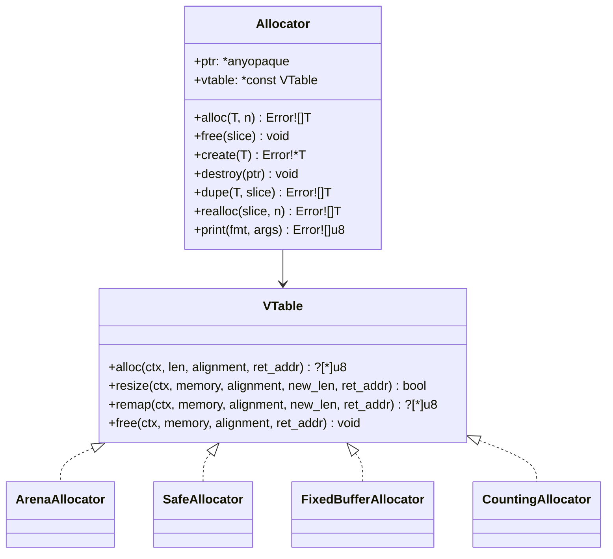

| VTable function | Contract | Returns |
| --- | --- | --- |
| `alloc` | Give me `len` bytes aligned to `alignment` | A pointer, or `null` for out of memory (helpers turn it into `error.OutOfMemory`) |
| `resize` | Grow or shrink in place | `true` if the address is unchanged and the new length is valid |
| `remap` | Grow or shrink, moving if needed | A possibly new pointer, or `null` to make the caller allocate, copy and free |
| `free` | Release memory previously returned | Nothing; the length and alignment must match the allocation |

Writing your own allocator means writing those four functions. This one wraps another allocator and tracks live and peak bytes, which is a quick way to measure the memory use of a code path:

```zig
/// Wraps another allocator and counts live bytes. Implementing the four
/// vtable functions is all it takes to plug into every std API.
const CountingAllocator = struct {
    child: Allocator,
    live_bytes: usize = 0,
    peak_bytes: usize = 0,

    fn allocator(self: *CountingAllocator) Allocator {
        return .{ .ptr = self, .vtable = &.{
            .alloc = alloc,
            .resize = resize,
            .remap = remap,
            .free = free,
        } };
    }

    fn track(self: *CountingAllocator, old_len: usize, new_len: usize) void {
        self.live_bytes = self.live_bytes - old_len + new_len;
        self.peak_bytes = @max(self.peak_bytes, self.live_bytes);
    }

    fn alloc(ctx: *anyopaque, len: usize, alignment: std.mem.Alignment, ret_addr: usize) ?[*]u8 {
        const self: *CountingAllocator = @ptrCast(@alignCast(ctx));
        const ptr = self.child.rawAlloc(len, alignment, ret_addr) orelse return null;
        self.track(0, len);
        return ptr;
    }

    fn resize(ctx: *anyopaque, memory: []u8, alignment: std.mem.Alignment, new_len: usize, ret_addr: usize) bool {
        const self: *CountingAllocator = @ptrCast(@alignCast(ctx));
        if (!self.child.rawResize(memory, alignment, new_len, ret_addr)) return false;
        self.track(memory.len, new_len);
        return true;
    }

    fn remap(ctx: *anyopaque, memory: []u8, alignment: std.mem.Alignment, new_len: usize, ret_addr: usize) ?[*]u8 {
        const self: *CountingAllocator = @ptrCast(@alignCast(ctx));
        const ptr = self.child.rawRemap(memory, alignment, new_len, ret_addr) orelse return null;
        self.track(memory.len, new_len);
        return ptr;
    }

    fn free(ctx: *anyopaque, memory: []u8, alignment: std.mem.Alignment, ret_addr: usize) void {
        const self: *CountingAllocator = @ptrCast(@alignCast(ctx));
        self.child.rawFree(memory, alignment, ret_addr);
        self.track(memory.len, 0);
    }
};

test "a custom allocator is just a vtable" {
    var counting: CountingAllocator = .{ .child = testing.allocator };
    const a = counting.allocator();

    var list: std.ArrayList(u64) = .empty;
    try list.appendSlice(a, &.{ 1, 2, 3, 4, 5, 6, 7, 8 });
    try testing.expect(counting.live_bytes >= 8 * @sizeOf(u64));
    list.deinit(a);
    try testing.expectEqual(0, counting.live_bytes);
    try testing.expect(counting.peak_bytes >= 64);
}
```

| Line / API | Role | What happens at runtime |
| :--- | :--- | :--- |
| `.{ .ptr = self, .vtable = &.{ ... } }` | Build the interface value | The vtable is a comptime-known constant, so `&.{...}` points into static memory |
| `@ptrCast(@alignCast(ctx))` | Recover the concrete type from `*anyopaque` | `@alignCast` is safety-checked; a misaligned pointer panics in safe builds |
| `self.child.rawAlloc(...)` | Forward to the wrapped allocator | `raw*` functions call the child's vtable directly, without the typed helpers |
| `ret_addr` | Caller's return address | Lets `SafeAllocator` record where an allocation came from, for leak reports |
| `self.track(memory.len, 0)` | Bookkeeping on free | `memory.len` is the length the caller originally asked for, a guarantee of the interface |

The interface passes the length on `free`. Unlike C's `free(ptr)`, the allocator does not need to store a size header, which is part of why arenas and bump allocators are so cheap in Zig.

### 3.3 Choosing an Allocator

```zig
test "FixedBufferAllocator: heap-style API over stack memory" {
    var storage: [256]u8 = undefined;
    var fba: std.heap.FixedBufferAllocator = .init(&storage);
    const a = fba.allocator();

    const nums = try a.alloc(u32, 16); // 64 bytes out of 256
    defer a.free(nums);
    try testing.expectError(error.OutOfMemory, a.alloc(u8, 1024));
}

test "ArenaAllocator: many allocations, one free" {
    var arena: std.heap.ArenaAllocator = .init(testing.allocator);
    defer arena.deinit(); // frees everything below in one call
    const a = arena.allocator();

    for (0..100) |i| {
        _ = try a.print("item-{d}", .{i}); // no individual free needed
    }
}

test "SafeAllocator reports leaks on deinit" {
    var safe: std.heap.SafeAllocator = .init(std.heap.page_allocator, .{});
    const a = safe.allocator();
    const leaked = try a.alloc(u8, 10);
    _ = leaked;
    // deinitLog(false) returns the leak count without printing a report.
    try testing.expectEqual(1, safe.deinitLog(false));
}

test "BufferFirstAllocator: stack first, heap when it runs out" {
    var stack_buf: [64]u8 = undefined;
    var bfa: std.heap.BufferFirstAllocator = .init(&stack_buf, testing.allocator);
    const a = bfa.allocator();
    const small = try a.alloc(u8, 32); // served from stack_buf
    defer a.free(small);
    const large = try a.alloc(u8, 4096); // falls through to testing.allocator
    defer a.free(large);
}
```

| Allocator | Strategy | Thread-safe | Use it for | Avoid it for |
| --- | --- | --- | --- | --- |
| `init.gpa` (Juicy Main) | `SafeAllocator` in debug/safe, `smp_allocator` or `c_allocator` otherwise | Yes | The default for an application | Libraries: they should take an `Allocator` parameter instead |
| `std.heap.SafeAllocator` | Never reuses memory; footer with checksum, canary and stack trace per allocation | Yes | Development and tests; catching leaks, double frees, use-after-free | Hot paths in production (it trades memory and speed for checks) |
| `std.heap.smp_allocator` | Per-thread size-class free lists over page allocations | Yes | Release builds of multithreaded programs without libc | Debugging memory bugs |
| `std.heap.c_allocator` | `malloc`/`free` | Yes | Programs that link libc anyway, or mix memory with C libraries | Targets without libc |
| `std.heap.page_allocator` | `mmap`/`VirtualAlloc` per call, whole pages | Yes | Backing other allocators; a few large buffers | Many small allocations: each one costs at least a page and a syscall |
| `std.heap.ArenaAllocator` | Bump allocation over a child allocator; free is a no-op except for the last allocation | Yes, lock-free since 0.16 | Request-scoped or phase-scoped data, parsers, CLIs | Long-lived data with independent lifetimes; it only grows until reset |
| `std.heap.FixedBufferAllocator` | Bump allocation inside one caller buffer | No | Hard upper bounds, embedded, no-heap code | Unbounded input |
| `std.heap.BufferFirstAllocator` | Serves from a buffer, then falls back to a child | No | "Small vector" optimisation: common case on the stack | Cases where the fallback would dominate |
| `std.heap.MemoryPool(T)` | Free list of fixed-size `T` slots | No | Many objects of one type created and destroyed often | Mixed sizes |
| `std.testing.allocator` | `SafeAllocator` that fails the test on a leak | No | Every unit test | Anything outside tests |
| `std.testing.FailingAllocator` | Fails the Nth allocation | No | Testing out-of-memory paths and `errdefer` | |

The starter uses an arena per request. All of a request's allocations (the target copy, the body, the lowercased text, the hash map, the sorted list, the JSON output) come from one `ArenaAllocator`, and `defer _ = arena_state.reset(.retain_capacity);` in the accept loop frees them in one step. `.retain_capacity` keeps the pages, so after the first few requests the server stops calling the general purpose allocator at all.

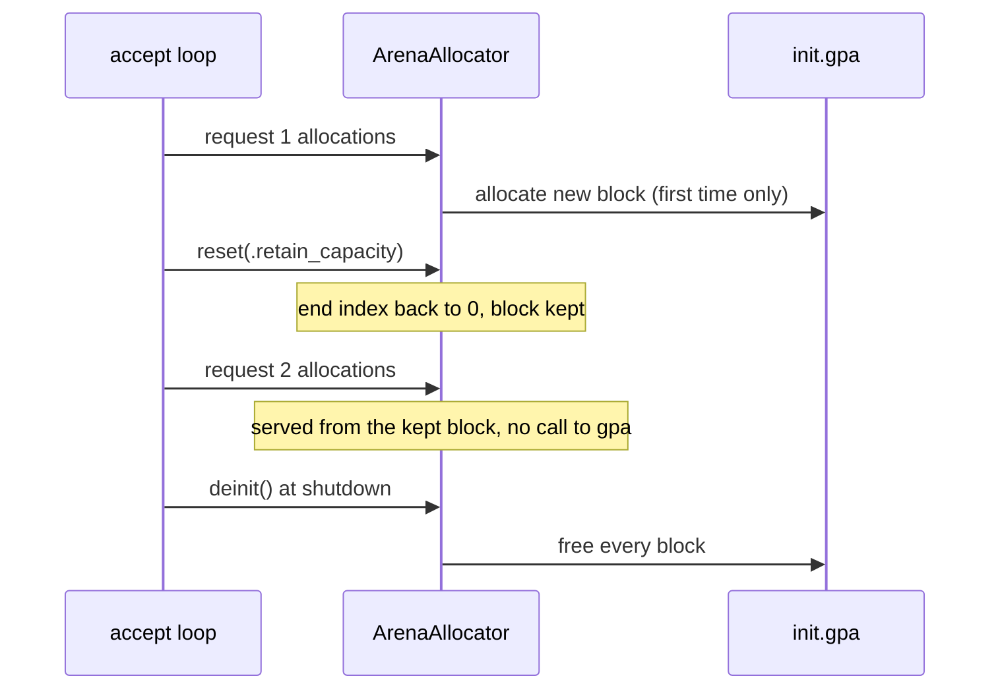

### 3.4 defer and errdefer

`defer` runs a statement when the enclosing block exits, in reverse order of declaration. `errdefer` runs only if the block exits by returning an error. Together they replace destructors and `goto cleanup` chains, and they keep the cleanup next to the acquisition.

```zig
const Buffers = struct {
    header: []u8,
    body: []u8,

    /// If the second allocation fails, errdefer frees the first one.
    /// On success, ownership of both moves to the caller.
    fn init(gpa: Allocator, header_len: usize, body_len: usize) !Buffers {
        const header = try gpa.alloc(u8, header_len);
        errdefer gpa.free(header);
        const body = try gpa.alloc(u8, body_len);
        return .{ .header = header, .body = body };
    }

    fn deinit(b: Buffers, gpa: Allocator) void {
        gpa.free(b.body);
        gpa.free(b.header);
    }
};

test "errdefer cleans up partial initialisation" {
    // Fail the second allocation; testing.allocator would report a leak if
    // errdefer did not run.
    var failing: std.testing.FailingAllocator = .init(testing.allocator, .{ .fail_index = 1 });
    try testing.expectError(error.OutOfMemory, Buffers.init(failing.allocator(), 8, 8));

    const ok = try Buffers.init(testing.allocator, 8, 8);
    ok.deinit(testing.allocator);
}

test "defer runs in reverse order at scope exit" {
    var log: [3]u8 = undefined;
    var n: usize = 0;
    {
        defer {
            log[n] = 'a';
            n += 1;
        }
        defer {
            log[n] = 'b';
            n += 1;
        }
        log[n] = 'c';
        n += 1;
    }
    try testing.expectEqualStrings("cba", &log);
}
```

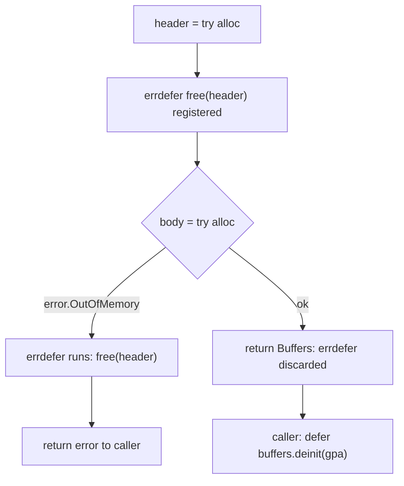

| Rule | Detail |
| --- | --- |
| Scope | `defer` is tied to the enclosing block, not the function; a `defer` inside a loop body runs at the end of each iteration |
| Order | Last registered runs first |
| Control flow | A deferred block cannot `return` or use `try`; errors inside must be handled there |
| Arguments | Evaluated when the defer runs, not when it is declared |
| `errdefer` and ownership | Use `errdefer` between acquiring a resource and handing it to the caller; once ownership transfers, the caller's `defer` takes over |
| No capture (0.17) | `errdefer \|err\|` was removed; to log or translate the error, handle it at the call site with `catch \|err\|` |

The accept loop in `main.zig` uses two `defer`s inside the `while` body. Each one runs at the end of every iteration, so the stream is closed and the arena reset after each connection, even when `serve` fails.

### 3.5 Error Sets and Error Unions

An error set is an enum-like set of names. An error union `E!T` holds either an error from `E` or a value of `T`. Errors are values, not exceptions: they travel only through return values, and `try` is the visible marker at each point where one can propagate.

```zig
const ParseError = error{ Empty, NotANumber, TooLarge };

fn parsePercent(text: []const u8) ParseError!u7 {
    if (text.len == 0) return error.Empty;
    const n = std.fmt.parseInt(u32, text, 10) catch return error.NotANumber;
    if (n > 100) return error.TooLarge;
    return @intCast(n);
}

/// The error set is inferred (`!u7`) and includes everything parsePercent
/// can return, plus error.Negative.
fn parseSigned(text: []const u8) !u7 {
    if (text.len > 0 and text[0] == '-') return error.Negative;
    return parsePercent(text);
}

test "error unions, try, catch and switch on errors" {
    try testing.expectEqual(42, try parsePercent("42"));
    try testing.expectError(error.TooLarge, parsePercent("101"));

    const with_default = parsePercent("") catch 50;
    try testing.expectEqual(50, with_default);

    const message = if (parseSigned("-5")) |_| "ok" else |err| switch (err) {
        error.Negative => "negative",
        error.Empty, error.NotANumber, error.TooLarge => "invalid",
    };
    try testing.expectEqualStrings("negative", message);

    // Error sets merge with ||.
    const AllErrors = ParseError || error{Negative};
    const e: AllErrors = error.Empty;
    try testing.expectEqualStrings("Empty", @errorName(e));
}
```

| Form | Meaning |
| --- | --- |
| `try expr` | `expr catch \|e\| return e`: propagate the error, unwrap the value |
| `expr catch default` | Replace any error with a value |
| `expr catch \|e\| switch (e) { ... }` | Handle each error; the switch must be exhaustive over the set |
| `if (expr) \|v\| { ... } else \|e\| { ... }` | Branch on success or failure |
| `!T` in a return type | Inferred error set: the compiler collects every error the body can return |
| `A \|\| B` | Union of two error sets |
| `anyerror` | The global set of all errors; avoid in signatures because it hides what can fail |
| `error.OutOfMemory => \|e\| return e` | Re-raise one error while handling others, as `router.handle` does |
| `catch unreachable` | Assert that it cannot fail; panics in safe builds if wrong |

In Debug and `safe` builds, each `try` that propagates an error appends to an **error return trace**. When `main` returns an error, the trace shows every function the error passed through, not just where it was created:

```text
error: Boom
/w/ed.zig:2:16: 0x11e2f1c in f (ed.zig)
fn f() !void { return error.Boom; }
               ^
/w/ed.zig:3:16: 0x11e2f77 in g (ed.zig)
fn g() !void { try f(); }
               ^
/w/ed.zig:4:23: 0x11e2ff7 in main (ed.zig)
pub fn main() !void { try g(); }
                      ^
```

The router shows how to translate errors at a boundary. `text.analyze` can fail with `InputTooLarge` (the client's fault) or `OutOfMemory` (the server's). The router turns the first into an HTTP 413 and propagates the second unchanged:

```zig
const report = text.analyze(arena, body, top_n) catch |err| switch (err) {
    error.InputTooLarge => return errorBody(arena, .payload_too_large, "body exceeds 64 KiB"),
    error.OutOfMemory => |e| return e,
};
```

Errors carry no payload. When you need details (a line number, the offending byte), return them through a separate out-parameter or a `Diagnostics` struct, as `std.json` and `std.zon` do, and keep the error itself as the category.

### 3.6 Pointers in Depth

Zig splits C's single pointer type into several, each saying how many items it points to and whether the length is known.

```zig
test "pointer kinds" {
    var arr = [_]u8{ 1, 2, 3, 4 };

    const one: *u8 = &arr[0]; // single item, no arithmetic
    one.* = 10;

    const to_array: *[4]u8 = &arr; // length is part of the type
    try testing.expectEqual(4, to_array.len);

    const slice: []u8 = arr[1..]; // pointer + runtime length
    slice[0] = 20;

    const many: [*]u8 = &arr; // unknown length, C-style, no bounds checks
    try testing.expectEqual(3, many[2]);

    const c_str: [*:0]const u8 = "abc"; // many-item, null-terminated
    try testing.expectEqual(3, std.mem.len(c_str));

    var maybe: ?*u8 = null; // only optional pointers can be null
    maybe = &arr[3];
    try testing.expectEqual(4, maybe.?.*);
    try testing.expectEqualSlices(u8, &.{ 10, 20, 3, 4 }, &arr);
}

test "alignment is part of the pointer type" {
    var x: u32 align(16) = 0;
    const p: *align(16) u32 = &x;
    try testing.expect(@intFromPtr(p) % 16 == 0);
    try testing.expectEqual(4, @alignOf(u32));
}
```

| Type | Points to | Indexing | Bounds-checked | Converts to |
| --- | --- | --- | --- | --- |
| `*T` | Exactly one `T` | No (`p.*` to dereference) | n/a | `[*]T` via `@ptrCast`, `*[1]T` |
| `*[N]T` | An array of N | `p[i]`, `p.len` | Yes | `[]T`, `[*]T` |
| `[]T` | A run of `len` items | `s[i]`, `s[a..b]` | Yes | `[*]T` via `s.ptr` |
| `[*]T` | Unknown number of items | `p[i]`, `p[a..b]` gives a slice | No | `[]T` by slicing with an explicit end |
| `[*:0]T`, `[:0]T` | Items followed by a sentinel | As above | Slice: yes | C strings |
| `?*T` | One `T` or null | After unwrapping | n/a | Same size as `*T` |
| `*const T` | Read-only view | | | `*T` coerces to `*const T`, not the other way |
| `*align(16) T` | Over-aligned `T` | | | Coerces to a less-aligned pointer |
| `*allowzero T` | Address 0 is valid | | | Embedded memory maps |
| `*volatile T` | Memory-mapped I/O | | | Every load and store is kept |

Pointer arithmetic exists only on many-item pointers and slices (`p + 1` on a `[*]T`), not on `*T`. The `const` qualifier is about the pointee: `[]const u8` means "I will not write through this slice", which is why std functions that only read take `[]const T`.

### 3.7 Comptime: Code That Runs in the Compiler

`comptime` marks values and code that must be known during compilation. The compiler contains an interpreter for Zig, so ordinary functions can run at compile time with no special syntax. This one feature covers what other languages do with macros, templates, constexpr and code generators.

```zig
/// A generic function: `T` is known at compile time, so each call with a new
/// type produces a specialised copy.
fn maxOf(comptime T: type, items: []const T) ?T {
    if (items.len == 0) return null;
    var best = items[0];
    for (items[1..]) |v| best = @max(best, v);
    return best;
}

fn fibonacci(n: u32) u64 {
    var a: u64 = 0;
    var b: u64 = 1;
    for (0..n) |_| {
        const next = a + b;
        a = b;
        b = next;
    }
    return a;
}

test "comptime generics" {
    try testing.expectEqual(9, maxOf(i32, &.{ 3, 9, -2 }).?);
    try testing.expectEqual(null, maxOf(f64, &.{}));

    // Any function can run at compile time; the result is a constant.
    const table = comptime blk: {
        var t: [10]u64 = undefined;
        for (&t, 0..) |*slot, i| slot.* = fibonacci(@intCast(i));
        break :blk t;
    };
    try testing.expectEqual(34, table[9]);
}
```

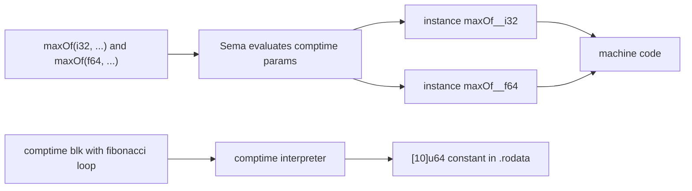

| Where `comptime` appears | Effect |
| --- | --- |
| `comptime T: type` parameter | Callers must pass a compile-time-known value; each distinct value creates a new function instance |
| `comptime expr` or `comptime { ... }` | Forces evaluation at compile time; anything that needs runtime (I/O, runtime variables) is a compile error |
| Top-level `comptime { ... }` | Runs on every build; `root.zig` uses it to assert the roadmap has seven stages |
| `inline for` / `inline while` | Unrolls the loop at compile time, so the loop variable can be a type or a field name |
| `@compileError("msg")` | Fails the build with a custom message when reached during analysis, as `RingBuffer(T, 0)` does |
| `@setEvalBranchQuota(n)` | Raises the limit on backward branches during comptime evaluation (default 1000) |

There is no separate macro language and no way for comptime code to perform I/O or read the host environment (the one controlled exception is `@embedFile`, which the build system tracks as an input), so builds stay reproducible. Comptime code is not sandboxed for time, though. A heavy computation slows every build, so precompute tables at comptime only when they are small or expensive to compute at startup.

### 3.8 Generic Types and Reflection

A generic type is a function that takes `comptime` parameters and returns a `type`. There is no special syntax; `std.ArrayList(u32)` is a function call that returns a struct type, and the result is cached so equal arguments produce the same type.

```zig
/// A generic type: a function that returns a struct.
fn Pair(comptime A: type, comptime B: type) type {
    return struct {
        first: A,
        second: B,

        const Self = @This();
        fn swap(self: Self) Pair(B, A) {
            return .{ .first = self.second, .second = self.first };
        }
    };
}
```

The starter's `RingBuffer` is a real generic type. Its capacity is a comptime parameter, so the storage is an inline array and a zero capacity is rejected at compile time:

```zig
pub fn RingBuffer(comptime T: type, comptime capacity: usize) type {
    if (capacity == 0) @compileError("RingBuffer capacity must be at least 1");

    return struct {
        const Self = @This();

        items: [capacity]T = undefined,
        /// Index of the oldest element.
        head: usize = 0,
        len: usize = 0,

        pub const empty: Self = .{};
        pub const max_len = capacity;

        /// Appends `value`. When the buffer is full the oldest element is
        /// overwritten and returned so the caller can see what was evicted.
        pub fn push(self: *Self, value: T) ?T {
            if (self.len < capacity) {
                self.items[(self.head + self.len) % capacity] = value;
                self.len += 1;
                return null;
            }
            const evicted = self.items[self.head];
            self.items[self.head] = value;
            self.head = (self.head + 1) % capacity;
            return evicted;
        }

        /// Returns the element at logical position `index`, where 0 is the
        /// oldest element still stored.
        pub fn get(self: *const Self, index: usize) ?T {
            if (index >= self.len) return null;
            return self.items[(self.head + index) % capacity];
        }

        pub fn newest(self: *const Self) ?T {
            if (self.len == 0) return null;
            return self.get(self.len - 1);
        }

        /// Copies the stored elements, oldest first, into `out` and returns
        /// the filled prefix.
        pub fn copyInto(self: *const Self, out: []T) []T {
            const n = @min(out.len, self.len);
            for (out[0..n], 0..) |*slot, i| slot.* = self.get(i).?;
            return out[0..n];
        }
    };
}
```

| Line / API | Role | What happens at runtime |
| :--- | :--- | :--- |
| `comptime capacity: usize` | Size is part of the type | `RingBuffer(u32, 3)` and `RingBuffer(u32, 4)` are different types |
| `@compileError(...)` | Reject bad instantiations | Only fires if `capacity == 0` is actually instantiated |
| `items: [capacity]T = undefined` | Inline storage | The buffer lives wherever the struct lives (inside `App`, on the stack) |
| `pub const empty: Self = .{};` | Decl literal | `var r: RingBuffer(u8, 4) = .empty;` |
| `% capacity` | Wrap-around index | When `capacity` is a power of two, the optimiser turns `%` into a mask |

Reflection uses `@typeInfo`, which returns a `std.lang.Type` describing any type. Since 0.17, struct, enum and union info is laid out as parallel slices:

```zig
const Config = struct {
    port: u16 = 8080,
    host: []const u8 = "0.0.0.0",
    verbose: bool = false,
};

/// Reflection: count fields of a given type. @typeInfo returns field names
/// and types as parallel arrays (struct-of-arrays) since 0.17.
fn countFieldsOfType(comptime S: type, comptime F: type) usize {
    const info = @typeInfo(S).@"struct";
    var n: usize = 0;
    inline for (info.field_types) |T| {
        if (T == F) n += 1;
    }
    return n;
}

test "reflection with @typeInfo and @field" {
    try testing.expectEqual(1, comptime countFieldsOfType(Config, bool));
    const info = @typeInfo(Config).@"struct";
    try testing.expectEqualStrings("port", info.field_names[0]);

    const c: Config = .{};
    try testing.expectEqual(8080, @field(c, "port"));
    try testing.expect(@hasField(Config, "host"));
}
```

| Builtin | Gives you |
| --- | --- |
| `@typeInfo(T)` | Kind-specific info: `.@"struct"` (`field_names`, `field_types`, `field_attrs`, `decl_names`, `layout`), `.@"enum"`, `.int`, `.pointer` and so on |
| `@field(value, "name")` | Field access by a comptime string; also works on the left of `=` |
| `@hasField(T, "name")`, `@hasDecl(T, "name")` | Presence checks; `@hasDecl` only sees `pub` declarations in 0.17 |
| `@FieldType(T, "name")` | The type of one field |
| `@TypeOf(expr)` | The type of an expression, without evaluating it at runtime |
| `@typeName(T)` | A readable name, for error messages and logs |
| `@Int`, `@Struct`, `@Enum`, `@Union`, `@Pointer`, `@Fn`, `@Tuple` | Build new types (replaced `@Type` in 0.16) |

`std.json.Stringify` is built this way: it walks `@typeInfo` of whatever you pass, which is why `router.handle` can serialise `text.Report`, anonymous structs and slices of `Summary` without any annotations.

### 3.9 Memory Layout: auto, extern and packed

A plain `struct` has no guaranteed layout: the compiler may reorder fields to reduce padding. When the bytes matter (a C ABI, a file format, a hardware register), say so.

```zig
const Auto = struct { a: u8, b: u32, c: u8 }; // compiler may reorder fields
const CLayout = extern struct { a: u8, b: u32, c: u8 }; // C ABI order and padding
const Flags = packed struct(u8) { read: bool, write: bool, exec: bool, _pad: u5 = 0 };

test "layout: auto, extern and packed" {
    try testing.expectEqual(12, @sizeOf(CLayout)); // 1 + 3 pad + 4 + 1 + 3 pad
    try testing.expectEqual(4, @offsetOf(CLayout, "b"));
    try testing.expect(@sizeOf(Auto) <= @sizeOf(CLayout)); // reordering may shrink it

    const f: Flags = .{ .read = true, .write = false, .exec = true };
    try testing.expectEqual(0b101, @as(u8, @bitCast(f)));
    try testing.expectEqual(1, @sizeOf(Flags));
}
```

| Kind | Field order | Padding | Can contain | Use for |
| --- | --- | --- | --- | --- |
| `struct` | Compiler's choice | Compiler's choice | Anything | All ordinary code |
| `extern struct` | As written | C ABI rules for the target | C-compatible types only | Passing structs to and from C, mmap'd file headers |
| `packed struct(uN)` | As written, first field in the least significant bits | None | Integers, bools, enums with explicit tag types, other packed types (no pointers since 0.16) | Bit flags, protocol headers, hardware registers |

`@sizeOf`, `@alignOf`, `@offsetOf` and `@bitOffsetOf` report the layout, and you can assert it at compile time: `comptime std.debug.assert(@sizeOf(Header) == 16);`. `@bitCast` reinterprets the bits of a value as another type of the same size, which is how a packed struct becomes the `u8` written to a register.

The ring buffer test in [`src/ring.zig`](src/ring.zig) uses `@sizeOf` to prove a structural claim: a `RingBuffer(u64, 8)` is exactly eight `u64` slots plus two `usize` counters, with no hidden heap pointer.

### 3.10 Illegal Behavior and Build Modes

Zig calls operations whose result is not defined "illegal behavior": integer overflow with plain operators, out-of-bounds access, unwrapping null, reaching `unreachable`, a bad `@intCast`, reading the inactive field of a bare union, misaligned `@alignCast`. Some are caught at compile time. The rest are **safety-checked** at runtime in builds with runtime safety on, and **assumed not to happen** in builds with it off.

| `-Doptimize=` | `builtin.mode` | Runtime safety | Optimiser | Typical use |
| --- | --- | --- | --- | --- |
| `debug` (default) | `.debug` | On | Off; self-hosted backend on x86_64 | Development, tests |
| `safe` | `.safe` | On | LLVM, full | Production services where a crash beats corruption; this repo's Dockerfile |
| `fast` | `.fast` | Off | LLVM, full | Proven hot code, benchmarks, games |
| `small` | `.small` | Off | LLVM, size | Embedded, WebAssembly, tiny CLIs |

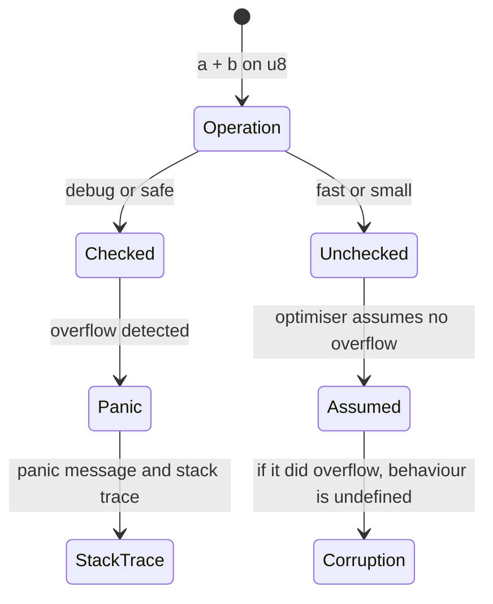

Safety can be toggled per scope with `@setRuntimeSafety(false)` inside a block, for example in an inner loop you have proven correct, while the rest of the program stays checked. `std.debug.assert(x)` is the same mechanism: it is `if (!x) unreachable`, so in `fast` builds a false assertion is something the optimiser may exploit, not a check.

Memory-safety bugs on the heap are a different category; the type system does not prevent use-after-free or double free. `SafeAllocator` (and so `init.gpa` in debug and safe builds, and `std.testing.allocator`) detects them at runtime with reports like these, captured from Zig 0.17:

```text
thread 8 panic: write after free at *7044264529e0
original alloc of [addr: 7044264529e0, len: 16 (0x10) align: 1]:
/w/uaf.zig:3:33: 0x11e2f94 in main (uaf.zig)
    const p = try init.gpa.alloc(u8, 16);

thread 17 panic: double free of [addr: 72ae8adfa9e0, len: 16 (0x10) align: 1]
```

Write-after-free is detected when the allocator next checks the freed memory (at the latest in `deinit`), not at the faulting write, so the panic can appear some time after the bug. Double free and frees of foreign pointers are caught immediately.

### 3.11 Pitfalls

| Pitfall | Symptom | Fix |
| --- | --- | --- |
| Forgetting to free in a test | `[SafeAllocator] (err): leaked [addr: ..., len: 3 (0x3) align: 1] allocated at:` followed by `1 tests leaked memory.` | Add `defer allocator.free(x)` right after the allocation, or use an arena in the code under test |
| Returning arena memory from a function whose arena dies | Garbage JSON or crashes on the next request | Copy what must outlive the arena into longer-lived storage, as `App.remember` does |
| Reading the request `head` after starting the body reader | Corrupted target or headers | Copy `head` fields first (`arena.dupe`), as `main.zig` does |
| `errdefer` placed after the call that hands ownership away | Double free when a later step fails | Put `errdefer` immediately after acquiring and before any transfer |
| Using `errdefer \|err\|` from older code | `error: expected block or expression, found '\|'` | Handle the error at the caller with `catch \|err\|`, or split the function |
| Using `page_allocator` for many small allocations | Very slow code; each allocation is a syscall and at least a page | Put an arena or `smp_allocator` in front of it |
| Freeing with a different allocator than the one that allocated | `SafeAllocator` panics on the canary or the free; other allocators corrupt memory | Keep allocator and allocation together, e.g. store the allocator in the struct that owns the memory |
| Writing through a freed slice | `panic: write after free at *...`, reported later than the write | Set slices to `undefined` or `&.{}` after freeing; keep ownership in one place |
| Assuming `fast` builds keep `assert` and bounds checks | Silent corruption only in release benchmarks | Ship `safe`, or keep explicit `if (...) return error.X` checks for untrusted input |
| Treating a plain `struct` as having C layout | Wrong values on the C side, or misread file headers | Use `extern struct`, and assert `@sizeOf`/`@offsetOf` at comptime |
| Accessing the inactive field of a bare union | `panic: access of union field 'b' while field 'a' is active` | Use a tagged union (`union(enum)`) and `switch` on it |
| Comptime loop that runs too long | `error: evaluation exceeded 1000 backwards branches` | `@setEvalBranchQuota(n)` with a justified number, or move the work to runtime |

### 3.12 Best Practices

- **Accept an `Allocator` parameter in libraries, never pick one**: the caller knows the lifetime and performance needs.
- **Use one arena per request, job or phase**: it removes individual frees and makes leaks within the phase impossible.
- **Run every test with `std.testing.allocator`**: leaks, double frees and use-after-free fail the test with a stack trace.
- **Test out-of-memory paths with `std.testing.FailingAllocator`** (or `std.testing.checkAllAllocationFailures`): it proves every `errdefer` is in place.
- **Write `defer`/`errdefer` on the line after the acquisition**: reviewers can check each resource locally.
- **Return precise error sets from public functions**: callers can switch exhaustively, and new errors become compile errors for them.
- **Prefer slices to many-item pointers**: you keep bounds checks; convert to `[*]T` only at C boundaries.
- **Use `comptime T: type` instead of `anytype` in public APIs**: better errors and self-documenting signatures.
- **Assert struct layouts at comptime when the bytes cross a boundary**: a layout change becomes a build failure, not a production bug.
- **Ship `safe` unless profiling proves a hot path needs `fast`**: then disable safety only in that scope with `@setRuntimeSafety(false)`.

### 3.13 Hands-on Exercise

Make `text.analyze` allocation-bounded and prove it with tests.

1. Copy the `CountingAllocator` from [`examples/stage3_memory.zig`](examples/stage3_memory.zig) into a new test in `src/text.zig`, wrap `std.testing.allocator` with it, and back an `ArenaAllocator` with the counter (`.init(counting.allocator())`). Pass the arena to `analyze` and assert that analysing a 1 KiB input peaks below 16 KiB, then that `arena.deinit()` brings `live_bytes` back to 0.
2. Add a test that calls `analyze` with a `std.testing.FailingAllocator` set to fail each allocation index from 0 to 3 in turn, and check that every call returns `error.OutOfMemory` without leaking. `std.testing.checkAllAllocationFailures` automates this loop if you want to try it.
3. Generalise `RingBuffer` with a third comptime parameter `overwrite: bool`. When it is `false`, `push` returns `error.Full` instead of evicting, so the return type must change with the parameter: `if (overwrite) ?T else error{Full}!void`.

Expected output:

```bash
zig build test --summary all
# every step succeeds; the new tests are listed under the root.zig test binary
```

Reference points: the allocator wrapper is in [`examples/stage3_memory.zig`](examples/stage3_memory.zig), the `errdefer` pattern in the same file's `Buffers.init`, and the generic type in [`src/ring.zig`](src/ring.zig).

[Back to top ⤴️](#-table-of-contents)

---

## 4. Stage 4: Concurrency & the Io Interface

Since 0.16, everything that can block or introduce nondeterminism (files, sockets, timers, randomness, spawning tasks) goes through a `std.Io` value that you pass around like an `Allocator`. This stage explains the interface, futures, groups and synchronisation, and where raw threads and atomics still fit. It assumes Stage 3.

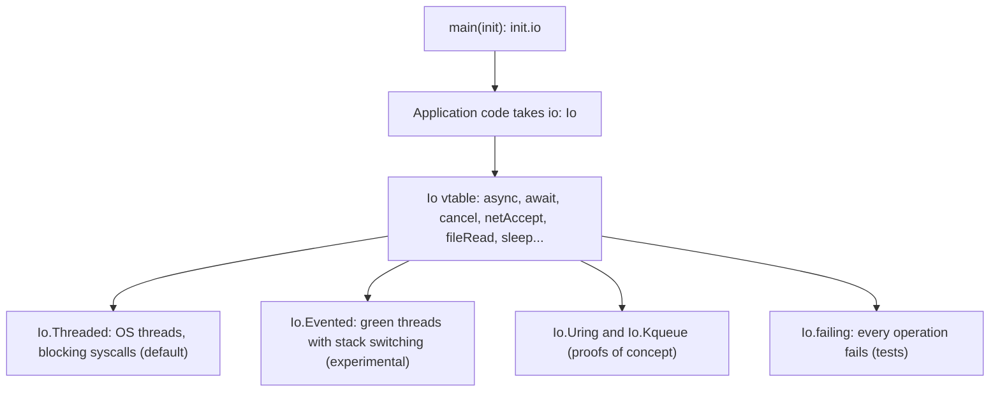

### 4.1 Why I/O Became an Interface

Before 0.16, `std.fs` and `std.net` called the operating system directly, so a library had no way to run under an event loop, a test double or a single-threaded WebAssembly host. Passing `io: Io` makes the choice the application's, exactly as passing `Allocator` does for memory. The same `serve` function in `main.zig` would run unchanged on `Io.Evented` once it matures.

| Concern | Before 0.16 | 0.16 and later |
| --- | --- | --- |
| Who chooses the I/O model | The library, implicitly | The application, by constructing an `Io` |
| Function colouring (async vs sync) | `async`/`await` keywords (removed in 0.15) | None: the same code runs blocking or evented |
| Testing | Real files and sockets | `std.testing.io`, or `Io.failing` to test error paths |
| Cancelation | Ad hoc | Built in: `Future.cancel` makes the next I/O call return `error.Canceled` |
| Getting an `Io` | n/a | `init.io` in `main`; `std.testing.io` in tests |

### 4.2 Futures: io.async and io.concurrent

`io.async(f, args)` says "this call is independent of what follows". It returns a `Future(T)`, and `future.await(io)` returns `f`'s result. An implementation may run the call on another thread, on a green thread, or immediately on the spot; the code is correct in every case. `io.concurrent` is the stronger request: the task must actually run concurrently (for example, a producer and a consumer on the same queue), so it can fail with `error.ConcurrencyUnavailable`.

```zig
fn checksum(data: []const u8) u32 {
    var h: u32 = 2166136261; // FNV-1a
    for (data) |b| {
        h ^= b;
        h *%= 16777619;
    }
    return h;
}

test "io.async expresses independence; await collects the result" {
    const io = testing.io;
    var a = io.async(checksum, .{"left half"});
    var b = io.async(checksum, .{"right half"});
    // Whether these ran in parallel depends on the Io implementation; the
    // code is correct either way.
    const total = a.await(io) +% b.await(io);
    try testing.expectEqual(checksum("left half") +% checksum("right half"), total);
}
```

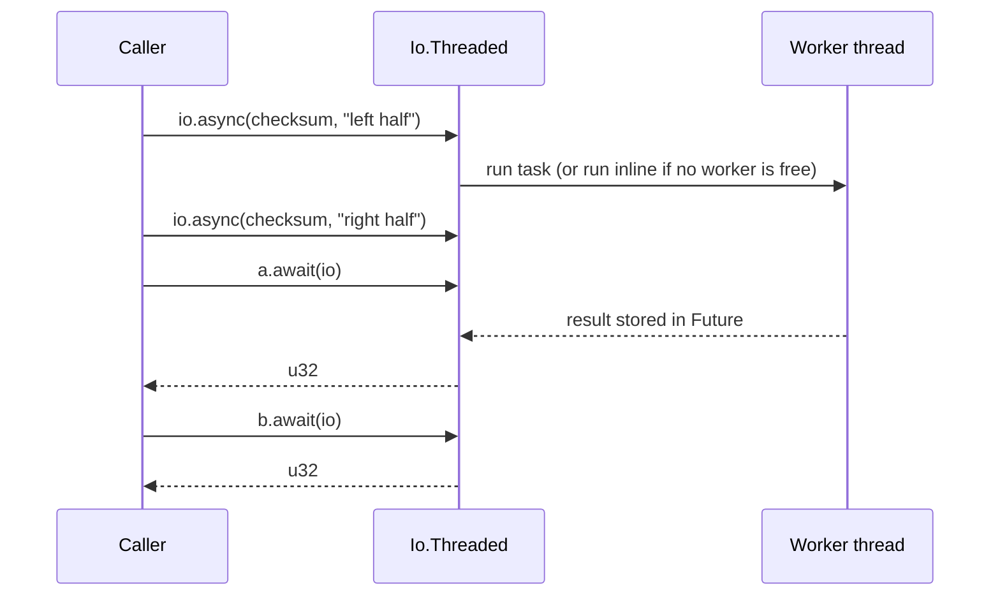

Every `Future` must be awaited or canceled, usually with `defer _ = future.cancel(io);` right after creating it, so an early `return` does not leak the task.

### 4.3 Groups and Shared State

An `Io.Group` holds any number of tasks that are awaited or canceled together, which replaces `std.Thread.Pool` plus `WaitGroup`. Shared state needs synchronisation; `Io.Mutex` takes the `io` so that a blocked task can yield under an evented implementation instead of blocking an OS thread.

```zig
const Counter = struct {
    mutex: Io.Mutex = .init,
    value: u64 = 0,

    fn addMany(c: *Counter, io: Io, n: u64) Io.Cancelable!void {
        for (0..n) |_| {
            try c.mutex.lock(io);
            defer c.mutex.unlock(io);
            c.value += 1;
        }
    }
};

test "a Group awaits many tasks together" {
    const io = testing.io;
    var counter: Counter = .{};
    var group: Io.Group = .init;
    for (0..4) |_| group.async(io, Counter.addMany, .{ &counter, io, 1000 });
    try group.await(io);
    try testing.expectEqual(4000, counter.value);
}
```

| Primitive | Use it for |
| --- | --- |
| `Io.Group` | Fan-out of independent tasks; the starter's accept loop will spawn one task per connection with `group.async` |
| `Io.Mutex`, `Io.RwLock`, `Io.Condition` | Shared mutable state between tasks |
| `Io.Event` | One-shot signal, such as "shutdown requested" |
| `Io.Queue(T)` | Bounded multi-producer, multi-consumer channel with backpressure |
| `Io.Select`, `Io.Batch` | Wait for the first of several tasks or operations to finish |
| `io.sleep(duration, clock)` | Timers; also a cancelation point |

### 4.4 Threads and Atomics Below Io

`std.Thread.spawn` and `std.atomic.Value(T)` still exist for code that needs an OS thread with a known identity (a pinned worker, a real-time audio callback) or lock-free data structures. Most application code should use `Io` instead, so that the concurrency model stays swappable.

```zig
const std = @import("std");

test "atomics with explicit memory ordering" {
    var hits: std.atomic.Value(u32) = .init(0);
    const worker = struct {
        fn run(h: *std.atomic.Value(u32)) void {
            for (0..1000) |_| _ = h.fetchAdd(1, .monotonic);
        }
    }.run;

    var threads: [4]std.Thread = undefined;
    for (&threads) |*t| t.* = try std.Thread.spawn(.{}, worker, .{&hits});
    for (threads) |t| t.join();
    try std.testing.expectEqual(4000, hits.load(.acquire));
}
```

| Ordering | Guarantees | Typical use |
| --- | --- | --- |
| `.monotonic` | Atomicity only | Counters and statistics |
| `.acquire` / `.release` | Publishing data from one thread to another | Flags that guard other memory, lock implementations |
| `.acq_rel` | Both, on read-modify-write | Reference counts reaching zero |
| `.seq_cst` | A single global order | Rarely needed; easiest to reason about |

[Back to top ⤴️](#-table-of-contents)

---

## 5. Stage 5: I/O, Networking, HTTP & Testing

This stage covers the byte-stream interfaces, files and sockets through `Io`, the std HTTP server and client, and Zig's built-in testing tools. It assumes Stage 4.

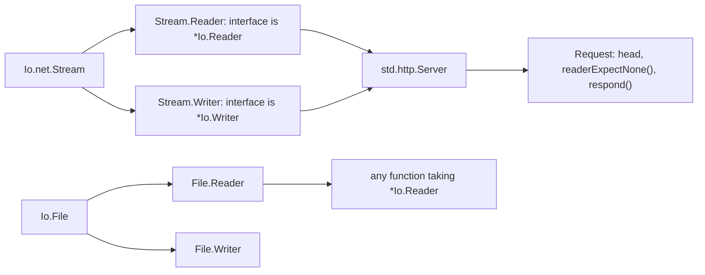

### 5.1 Reader and Writer

`std.Io.Reader` and `std.Io.Writer` are concrete structs with a caller-supplied buffer and a vtable. A function that takes `*Io.Reader` works on files, sockets, compressed streams and in-memory buffers without generics.

```zig
/// Sums one integer per line. Works on any reader: a file, a socket, stdin
/// or, in this test, a fixed in-memory buffer.
fn sumLines(r: *Io.Reader) !i64 {
    var total: i64 = 0;
    while (try r.takeDelimiter('\n')) |line| {
        const trimmed = std.mem.trim(u8, line, " \r");
        if (trimmed.len == 0) continue;
        total += try std.fmt.parseInt(i64, trimmed, 10);
    }
    return total;
}

test "the same function reads memory and files" {
    var mem_reader: Io.Reader = .fixed("10\n20\n\n-5\n");
    try testing.expectEqual(25, try sumLines(&mem_reader));

    const io = testing.io;
    var tmp = testing.tmpDir(.{});
    defer tmp.cleanup();

    const file = try tmp.dir.createFile(io, "numbers.txt", .{ .read = true });
    defer file.close(io);
    var wbuf: [64]u8 = undefined;
    var fw: Io.File.Writer = .init(file, io, &wbuf);
    try fw.interface.writeAll("1\n2\n3\n");
    try fw.interface.flush();

    var rbuf: [64]u8 = undefined;
    var fr: Io.File.Reader = .init(file, io, &rbuf);
    try fr.seekTo(0);
    try testing.expectEqual(6, try sumLines(&fr.interface));
}
```

`takeDelimiter` returns a slice into the reader's buffer, valid until the next read. A line longer than the buffer fails with `error.StreamTooLong`, so the buffer size is also your maximum line length.

### 5.2 TCP and HTTP with std.http.Server

`std.http.Server` handles one connection: you give it a reader and a writer, call `receiveHead()` for each request, and `respond()` to answer. Accepting connections, timeouts and concurrency are yours. The starter's `serve` function in [`src/main.zig`](src/main.zig) is a complete example; Stage 1.4 walks through it line by line.

| Step | API | Note |
| --- | --- | --- |
| Listen | `address.listen(io, .{ .reuse_address = true })` | Bind `0.0.0.0` in containers |
| Accept | `server.accept(io)` | Returns an `Io.net.Stream` |
| Parse headers | `http_server.receiveHead()` | Header size is limited by the reader's buffer |
| Read body | `request.readerExpectNone(&buf)` then `allocRemaining(arena, .limited(n))` | Always pass a limit |
| Respond | `request.respond(body, .{ .status = ..., .extra_headers = ... })` | Sets `content-length` and flushes |

### 5.3 Testing with test Blocks

A `test "name" { ... }` block can sit next to the code it tests, in the same file, with access to private declarations. `zig build test` compiles them into a test binary per module.

| Tool | Purpose |
| --- | --- |
| `std.testing.expect`, `expectEqual`, `expectEqualStrings`, `expectEqualSlices`, `expectError`, `expectApproxEqAbs` | Assertions; `expectEqual(expected, actual)` uses the expected value's type |
| `std.testing.allocator` | Fails the test on leaks |
| `std.testing.io` | An `Io` for tests |
| `std.testing.tmpDir(.{})` | A temporary directory, removed by `cleanup()` |
| `std.testing.fuzz(ctx, testOne, .{})` | Coverage-guided fuzzing with `zig build test --fuzz` |
| `error.SkipZigTest` | Return it to skip a test on unsupported platforms |
| `zig test file.zig --test-filter text` | Run only tests whose name contains `text` |

[Back to top ⤴️](#-table-of-contents)

---

## 6. Stage 6: Performance, Safety, C Interop & Shipping

This stage turns a working program into a shipped one: picking a build mode, cross-compiling, using C libraries, and producing a small static container image. It assumes the earlier stages.

```mermaid
flowchart LR
    SRC["Zig source + C headers"] --> TC["translate-c package: C header to Zig module"]
    TC --> BUILD["zig build -Doptimize=safe -Dtarget=..."]
    SRC --> BUILD
    BUILD --> BIN["Static binary (no libc, or musl)"]
    BIN --> IMG["distroless/static image, about 6.5 MB"]
    BUILD --> X1["x86_64-linux"]
    BUILD --> X2["aarch64-linux-musl"]
    BUILD --> X3["x86_64-windows"]
```

### 6.1 Build Modes in Practice

The build mode table is in [Stage 3.10](#310-illegal-behavior-and-build-modes). In practice: develop in `debug` for compile speed and full checks, ship services in `safe`, and switch individual hot functions to unchecked code with `@setRuntimeSafety(false)` only after a profiler has shown they matter. The starter's x86_64 binary built with `-Doptimize=safe` is about 4.4 MB because it keeps debug info and safety checks; the same code built with `-Doptimize=small -Dtarget=aarch64-linux-musl` is about 190 KB.

### 6.2 Cross-Compilation

Zig cross-compiles without installing anything else, because the compiler bundles the backends, a linker and libc headers and sources for many targets.

```bash
zig build -Doptimize=safe -Dtarget=aarch64-linux-musl     # Raspberry Pi, Graviton
zig build -Doptimize=safe -Dtarget=x86_64-windows-gnu     # .exe from Linux
zig build -Doptimize=small -Dtarget=wasm32-wasi           # WebAssembly, for code that only uses APIs WASI provides
zig targets | less                                         # everything the compiler supports
```

CI in this repo builds the starter for `aarch64-linux-musl` and `x86_64-windows-gnu` on every push, so a platform-specific API slipping into the code fails the build early.

### 6.3 C Interop Through the Build System

Zig calls C functions directly with no wrapper cost, because it can import C declarations as Zig declarations. Since 0.17 the translation is done by the official `translate-c` package in `build.zig`; the `@cImport` builtin is gone. Put the includes in a header:

```c
/* src/c.h */
#include <math.h>
#include <zlib.h>
```

Then translate it and expose the result as a module:

```zig
// build.zig, after `zig fetch --save git+https://codeberg.org/ziglang/translate-c#zig-0.17.x`
const Translator = @import("translate_c").Translator;

pub fn build(b: *std.Build) void {
    const target = b.standardTargetOptions(.{});
    const optimize = b.standardOptimizeOption(.{});

    const translator: Translator = .init(b.dependency("translate_c", .{}), .{
        .c_source_file = b.path("src/c.h"),
        .target = target,
        .optimize = optimize,
        .link_system_libs = &.{.{ .name = "z" }},
    });

    const exe = b.addExecutable(.{
        .name = "compress",
        .root_module = b.createModule(.{
            .root_source_file = b.path("src/main.zig"),
            .target = target,
            .optimize = optimize,
            .imports = &.{.{ .name = "c", .module = translator.mod }},
        }),
    });
    b.installArtifact(exe);
}
```

In Zig code, `const c = @import("c");` then gives `c.sqrt(2.0)` and `c.compressBound(len)`. Masterclass material in the next revision covers wrapping a C library behind an idiomatic Zig API.

### 6.4 Shipping a Static Binary in a Container

Without libc, Zig links Linux executables statically, so the runtime image needs no shared libraries at all. This repo's [`Dockerfile`](Dockerfile) verifies the Zig tarball's SHA-256, builds with `-Doptimize=safe`, and copies only the binary into `gcr.io/distroless/static-debian12:nonroot`. The result is about 6.5 MB and runs as a non-root user:

```bash
docker build -t learn-zig .
docker run --rm -p 8080:8080 learn-zig
curl -s localhost:8080/health    # {"status":"ok","requests":1}
```

[Back to top ⤴️](#-table-of-contents)

---

## 7. Stage 7: Staff Zig Systems Engineer Interview Handbook & Cheatsheet

The questions below test understanding of Stages 1-3 at the depth a staff-level interview expects: why the language works the way it does, what fails in production, and what you would choose instead. The handbook grows with each stage of this guide.

### 7.1 Core Concepts (Q1-Q10)

#### Q1. What are Zig's main design trade-offs compared with C and Rust?

Zig keeps C's model of manual memory management and a minimal runtime, and spends its complexity budget on making that model explicit and checkable rather than on preventing errors statically. Allocation is visible (every allocating function takes an `Allocator`), control flow is visible (no exceptions, no operator overloading, `try` at every propagation point), and most undefined behaviour of C becomes safety-checked illegal behavior in debug and `safe` builds.

Compared with Rust, the trade is compile-time guarantees for simplicity. Zig has no borrow checker, so use-after-free and data races are possible, and are found by `SafeAllocator`, tests and sanitizers instead of the type system. In exchange there are no lifetime annotations, generics are ordinary code run at compile time, and interop with C needs no binding layer. Compared with C, Zig adds slices with bounds checks, optionals instead of null pointers, error unions instead of `errno`, `defer`, a real module system, and a build system and cross-compiler in the same binary.

The cost that matters most in practice today is stability: Zig is pre-1.0, so every minor release breaks code. A team adopting it needs to budget for upgrades and to pin compiler versions.

#### Q2. What does "no hidden allocations" mean, and how does it change API design?

Nothing in the language allocates heap memory implicitly: there is no `new`, no boxing, no closures that capture onto the heap, no string concatenation at runtime. Any function that needs heap memory takes a `std.mem.Allocator` parameter, and containers take the allocator on each mutating call.

That shifts lifetime decisions to the caller. A library like `text.analyze` does not know whether it runs in a short request (where an arena is ideal), a long-lived cache (a general purpose allocator), or an embedded device (a fixed buffer), so it accepts an allocator and documents who owns the result. It also makes out-of-memory a normal, testable error: every allocation can fail with `error.OutOfMemory`, and `std.testing.FailingAllocator` can force each failure in turn.

The design pattern that follows is "allocator in, ownership documented": functions either return memory the caller must free with the same allocator, or require an arena and return views into it. Mixing the two in one API is the usual source of leaks.

#### Q3. Explain `comptime`. How does it replace generics, macros and code generation?

`comptime` means "evaluate this during compilation". The compiler embeds an interpreter for Zig, so any function can run at compile time if its inputs are known. Types are values at compile time, so a function can take a `type` parameter and return a new `type`.

Generics are therefore functions: `fn RingBuffer(comptime T: type, comptime capacity: usize) type` returns a struct, and each distinct argument tuple produces (and caches) one instantiation. Macros become ordinary code: lookup tables are computed in a `comptime` block, and `std.StaticStringMap.initComptime` builds a sorted table at compile time. Reflection uses `@typeInfo`, which is how `std.json` serialises arbitrary structs without code generation.

The limits are deliberate. Comptime code cannot do I/O, cannot depend on the host machine, and is bounded by `@setEvalBranchQuota`, which keeps builds reproducible. The main cost is compile time and error quality: errors in deeply generic code appear at instantiation, which is one reason to prefer `comptime T: type` over `anytype` in public APIs.

#### Q4. What is the difference between `[N]T`, `*[N]T`, `[]T`, `[*]T` and `[*:0]T`?

`[N]T` is an array value; its length is part of the type and assignment copies it. `*[N]T` is a pointer to such an array; it still knows N at compile time and coerces to a slice. `[]T` is a slice, a pointer plus a runtime length, bounds-checked in safe builds; this is the type most APIs take. `[*]T` is a many-item pointer with no length, like a C pointer: it allows indexing and arithmetic but no bounds checks, and exists mainly for C interop. `[*:0]T` adds a sentinel: the run ends at the first 0, which is how C strings are typed, and `std.mem.len` finds the length by scanning.

A practical rule: take `[]const T` in parameters, store `[]T` or owned arrays, and use `[*]T` and `[*:0]T` only at C boundaries, converting to slices as early as possible so bounds checks apply.

#### Q5. How do error unions work, and why are they not exceptions?

An error set is a set of global error names (internally small integers). An error union `E!T` is a tagged value that holds either an error from `E` or a `T`. Errors travel only through return values. `try x` is shorthand for `x catch |e| return e`, so every point where an error can leave a function is visible in the source. There is no stack unwinding, no hidden control flow and no allocation.

Compared with exceptions, the cost model is predictable (a return value and a branch), and the type system tracks which errors each function can return. Inferred error sets (`!T`) collect them automatically, and an exhaustive `switch` on an error forces callers to handle new errors when a dependency adds one. Debugging does not suffer either: in debug and `safe` builds, error return traces record every `try` an error passed through.

The limitation is that errors carry no payload. Context such as "line 12, column 3" goes into a separate diagnostics struct passed by the caller, as `std.json` and `std.zon` do.

#### Q6. When does `defer` run, and what problem does `errdefer` solve?

`defer stmt` runs `stmt` when the enclosing block exits, by any path, in reverse order of registration. Being tied to the block (not the function) matters in loops: a `defer` in a `while` body runs at the end of every iteration, which is how the starter closes each connection and resets the arena.

`errdefer` runs only when the block exits with an error. It solves partial initialisation: when a constructor acquires several resources and a later acquisition fails, the earlier ones must be released, but on success they must not be, because ownership moves to the caller. Placing `errdefer gpa.free(header);` right after allocating `header` gives exactly that behaviour without flags or `goto cleanup`.

Since 0.17, `errdefer` cannot capture the error. If cleanup needs to know which error happened (to log it, or to translate it), handle it at the call site with `catch |err|`.

#### Q7. Compare `ArenaAllocator`, `FixedBufferAllocator`, `SafeAllocator` and `smp_allocator`. When would you use each?

| Allocator | Free cost | Fragmentation | Safety checks | Best fit |
| --- | --- | --- | --- | --- |
| `ArenaAllocator` | Individual frees are mostly no-ops; one `reset`/`deinit` frees all | None within a phase; memory only grows until reset | None of its own; inherits the child's | Request, job or compiler-pass lifetimes |
| `FixedBufferAllocator` | Bump pointer; only the last allocation can be freed | None; fails when the buffer is full | Bounds by construction | Hard upper bounds, embedded, no heap |
| `SafeAllocator` | Never reuses memory | High by design | Leaks, double free, use-after-free, foreign frees | Debug builds and tests |
| `smp_allocator` | Size-class free lists per thread | Low for typical workloads | None | Release builds of multithreaded programs without libc |

A common production shape combines them: `init.gpa` (which is `SafeAllocator` in debug and `safe` builds) as the backing allocator, an arena per request on top of it, and occasionally a `BufferFirstAllocator` for small, hot, bounded paths. Libraries stay agnostic and accept whichever `Allocator` the caller passes.

#### Q8. What is illegal behavior, and how do the build modes treat it?

Illegal behavior is any operation whose result the language does not define: overflow with plain arithmetic, out-of-bounds indexing, unwrapping null, reaching `unreachable`, an `@intCast` that does not fit, reading the inactive field of a bare union, a misaligned `@alignCast`. When the compiler can prove it at compile time, it is a compile error. Otherwise, in `debug` and `safe` builds a runtime check panics with a message and stack trace; in `fast` and `small` builds there is no check, and the optimiser may assume it never happens.

The engineering consequence is that `std.debug.assert` and `.?` are not error handling. They are statements of fact that are checked in safe builds and exploited by the optimiser in fast builds. Validation of untrusted input must use real branches that return errors, as `config.parsePort` does before its `@intCast`. Many teams ship `safe` by default and disable checks only in profiled hot loops with `@setRuntimeSafety(false)`.

#### Q9. Why are std containers "unmanaged", and what are the consequences?

Since 0.15 for `ArrayList` and 0.16 for most others, std containers do not store an allocator. You pass it to every call that may allocate and to `deinit`. The container is smaller (no allocator field), the cost of each call is visible at the call site, and a container can be built with one allocator and then read without any, which suits arenas well.

The consequences: you must pass the same allocator consistently (mixing allocators frees memory into the wrong one, which `SafeAllocator` catches), and types that own containers usually store the allocator themselves once, or take it in `deinit(self, gpa)`. Initialisation uses decl literals: `var list: std.ArrayList(u32) = .empty;`.

#### Q10. How do modules, packages and `build.zig.zon` fit together?

A module is a root source file plus a set of named imports, with its own target and optimisation mode; `@import("name")` resolves through the importing module's import table. A package is a directory with a `build.zig.zon` that may expose modules and artifacts through its `build.zig`. Dependencies are recorded in the zon file by URL and content hash (`zig fetch --save`), and `b.dependency("name", .{...})` in `build.zig` makes their modules available.

The hash is the identity: if the bytes at a URL change, the build fails rather than silently pulling new code. The `.fingerprint` field identifies the package itself, so the package manager can tell a fork from the original. `.paths` controls which files belong to the package and therefore what the hash covers. For local development across repositories, `zig build --fork=/path/to/checkout` overrides a dependency with a local copy without editing the manifest.

### 7.5 Staff Cheatsheet

| Need | Zig answer | Gotcha |
| --- | --- | --- |
| Entry point with allocator, I/O and env | `pub fn main(init: std.process.Init) !void` | `init.gpa` changes implementation between debug and fast builds |
| Read an env var | `init.environ_map.get("PORT")` | No global environment; pass values into functions |
| Request-scoped memory | `var arena: std.heap.ArenaAllocator = .init(gpa);` then `reset(.retain_capacity)` | Do not keep arena slices past the reset |
| Growable list | `var l: std.ArrayList(T) = .empty; try l.append(gpa, x);` | Appending can move `items` |
| String-keyed map | `std.StringHashMapUnmanaged(V)` | Key bytes must outlive the map |
| Ordered map | `std.array_hash_map.Auto(K, V)` | Removal is swap or ordered, like a list |
| Fixed lookup table | `std.StaticStringMap(V).initComptime(.{...})` | Keys fixed at compile time |
| Cleanup | `defer x.deinit(gpa);` on the next line | `defer` in a loop runs every iteration |
| Partial-init cleanup | `errdefer gpa.free(a);` | No error capture since 0.17 |
| Propagate or translate errors | `try f()`, `f() catch \|e\| switch (e) {...}` | Avoid `anyerror` in public signatures |
| Checked narrowing | `@intCast` after a range check | In `fast` builds a failed cast is undefined |
| Wrapping math | `+%`, `*%` | Plain `+` panics on overflow in safe builds |
| Enum to int and back | `@backingInt(e)`, `@fromBackingInt(n)` | `@intFromEnum` is deprecated in 0.17 |
| Fill an array | `var a: [64]u8 = @splat(0);` | `**` was removed in 0.17 |
| Generic type | `fn Box(comptime T: type) type { return struct { ... }; }` | Each distinct argument tuple is a separate type |
| Reflection | `@typeInfo(T).@"struct".field_names` | Struct-of-arrays form since 0.17 |
| Format a custom type | `pub fn format(self, w: *std.Io.Writer) !void` and `{f}` | `{}` prints raw fields |
| Allocate a formatted string | `try gpa.print("{d}", .{n})` | `std.fmt.allocPrint` moved in 0.17 |
| C-compatible struct | `extern struct` | Plain `struct` layout is unspecified |
| Bit flags | `packed struct(u8)` and `@bitCast` | No pointers in packed types since 0.16 |
| Leak-checked tests | `std.testing.allocator` | Leaks fail the test run |
| Release build | `zig build -Doptimize=safe` | `ReleaseSafe` naming is gone from `std.lang.Optimize` |

[Back to top ⤴️](#-table-of-contents)

---

## 🧪 Example Projects

| Project | Builds on | What you practise | Stretch goal |
| --- | --- | --- | --- |
| [Text statistics service](./src/main.zig) (in this repo) | [Stage 1.4](#14-walking-through-the-starter-project), [Stage 2.4](#24-standard-containers), [Stage 3.3](#33-choosing-an-allocator) | Juicy Main, request arenas, hash maps, JSON, socket-free routing tests | Serve connections concurrently with `Io.Group` ([Stage 4.3](#43-groups-and-shared-state)) |
| `wc` clone | [Stage 1.8](#18-arrays-slices-and-strings), [Stage 5.1](#51-reader-and-writer) | `Io.Reader`, byte iteration, `std.process.Init` args | Handle UTF-8 code points with `std.unicode` |
| INI or `.env` parser | [Stage 2.5](#25-the-iterator-convention), [Stage 3.5](#35-error-sets-and-error-unions) | Iterators, `std.mem.cutScalar`, error sets with a diagnostics struct | Parse into any struct with `@typeInfo` |
| Bump and pool allocators | [Stage 3.2](#32-the-allocator-interface) | Implementing the `Allocator` vtable, alignment | Benchmark against `smp_allocator` |
| Generic LRU cache | [Stage 3.8](#38-generic-types-and-reflection), [Stage 2.4](#24-standard-containers) | `fn LruCache(comptime K: type, comptime V: type) type`, hash map plus intrusive list | Make it thread-safe with `Io.Mutex` |
| Binary file format reader | [Stage 3.9](#39-memory-layout-auto-extern-and-packed) | `extern struct` headers, `@bitCast`, endianness with `std.mem.readInt` | Write the format too, round-trip in tests |
| Bytecode VM | [Stage 1.10](#110-control-flow-as-expressions), [Stage 2.3](#23-enums-tagged-unions-and-switch) | Tagged unions for instructions, labeled `switch` dispatch | Add a comptime assembler for test programs |
| Static site generator | [Stage 5.1](#51-reader-and-writer), [Stage 6.2](#62-cross-compilation) | `Io.Dir` walking, writers, arenas per page | Cross-compile release binaries for three OSes in CI |

## 📝 Cheat Sheets

### CLI / Commands

```bash
zig version                                   # compiler version
zig env                                       # paths (std source, caches) as JSON
zig init                                      # new project in the current directory
zig build                                     # default install step -> zig-out/
zig build run -- arg1 arg2                    # build and run with arguments
zig build test --summary all                  # all tests, with a step tree
zig build --watch                             # rebuild on file changes
zig build --help                              # steps and -D options of this project
zig build -Doptimize=safe                     # optimised, safety checks on
zig build -Doptimize=fast                     # optimised, safety checks off
zig build -Doptimize=small                    # optimised for size
zig build -Dtarget=aarch64-linux-musl         # cross-compile
zig build --fetch                             # download dependencies only
zig build --fork=../my-fork-of-dep            # build against a local dependency checkout
zig run src/file.zig                          # compile and run one file
zig test src/file.zig                         # run one file's tests
zig test src/file.zig --test-filter "ring"    # run matching tests only
zig fmt src build.zig                         # format, and apply mechanical upgrades
zig fmt --check .                             # CI formatting gate
zig ast-check src/file.zig                    # quick syntax check
zig fetch --save git+https://host/owner/repo#v1.0.0   # add a dependency
zig targets                                   # supported targets
zig cc -o hello hello.c                       # use Zig as a C compiler
zig cc -target aarch64-linux-musl hello.c     # cross-compile C
zig translate-c header.h                      # print a C header as Zig declarations
```

### Syntax Quick Reference

| Task | Code |
| --- | --- |
| Constant and variable | `const a: u32 = 1; var b: u32 = 2;` |
| Array, inferred length | `const xs = [_]u8{ 1, 2, 3 };` |
| Array filled with a value | `var buf: [256]u8 = @splat(0);` |
| Slice of an array | `const s: []const u8 = xs[1..];` |
| Optional with default | `const v = maybe orelse 0;` |
| Optional capture | `if (maybe) \|v\| use(v);` |
| Error propagation | `const n = try parse(text);` |
| Error with default | `const n = parse(text) catch 0;` |
| For with index | `for (items, 0..) \|item, i\| {}` |
| Range loop | `for (0..10) \|i\| {}` |
| While with continue expr | `while (i < n) : (i += 1) {}` |
| Labeled block value | `const x = blk: { break :blk 42; };` |
| Switch with ranges | `switch (c) { 'a'...'z' => {}, else => {} }` |
| Struct with defaults | `const P = struct { x: i32 = 0 };` |
| Decl literal | `var list: std.ArrayList(u8) = .empty;` |
| Tagged union | `const U = union(enum) { a: u8, b: void };` |
| Generic function | `fn max(comptime T: type, a: T, b: T) T { return @max(a, b); }` |
| Generic type | `fn List(comptime T: type) type { return struct { items: []T }; }` |
| Comptime block | `const t = comptime buildTable();` |
| Defer cleanup | `defer gpa.free(buf);` |
| Test | `test "name" { try std.testing.expect(x == 1); }` |
| Format to stderr | `std.debug.print("{s} {d}\n", .{ name, n });` |
| Import | `const std = @import("std");` |

## 📚 Resources

- [Zig 0.17.0 language reference](https://ziglang.org/documentation/0.17.0/)
- [Zig 0.17.0 standard library documentation](https://ziglang.org/documentation/0.17.0/std/)
- [Zig 0.17.0 release notes](https://ziglang.org/download/0.17.0/release-notes.html)
- [Zig 0.16.0 release notes](https://ziglang.org/download/0.16.0/release-notes.html)
- [Zig downloads and checksums](https://ziglang.org/download/)
- [Learn Zig (official overview)](https://ziglang.org/learn/)
- [Zig source repository](https://codeberg.org/ziglang/zig)
- [translate-c package](https://codeberg.org/ziglang/translate-c)
- [Zig Software Foundation news](https://ziglang.org/news/)

## 🤝 Contributing

Contributions are welcome. Read the [contributing guide](https://github.com/TheLearningHubOrg/.github/blob/main/CONTRIBUTING.md) and the [code of conduct](https://github.com/TheLearningHubOrg/.github/blob/main/CODE_OF_CONDUCT.md) before you open a pull request. Commit messages follow [Conventional Commits](https://www.conventionalcommits.org/), which drive the automated changelog. Before pushing, run `zig fmt --check build.zig build.zig.zon src examples` and `zig build test`.

## 📄 License

This project is licensed under the MIT License. See the [LICENSE](LICENSE) file for details.

## 🙏 Acknowledgments

- [Zig](https://ziglang.org/) and the Zig Software Foundation
- [ZLS](https://github.com/zigtools/zls), the Zig language server
- [setup-zig](https://github.com/mlugg/setup-zig), used by this repo's CI
- [Distroless](https://github.com/GoogleContainerTools/distroless) base images

## 🌐 Connect with me

- [Twitter](https://twitter.com/manthan_ank)
- [LinkedIn](https://www.linkedin.com/in/manthanank)
- [Facebook](https://www.facebook.com/manthanank/)
- [Instagram](https://www.instagram.com/manthan_ank/)
- [YouTube](https://www.youtube.com/@manthanank)
- [GitHub](https://github.com/manthanank)

## ☕ Support

If you like this learning repository and find it useful, consider buying me a coffee or sponsoring me through GitHub Sponsors. Your support helps me keep these guides up to date. Thank you!

[](https://www.buymeacoffee.com/manthanank)

[](https://github.com/sponsors/manthanank)

---

Show your support by 🌟 the repository.
