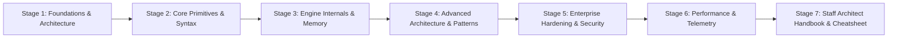

# Learn Zig Systems Programming & Comptime Architecture 🚀

<div align="center">

[](https://opensource.org/licenses/MIT)
[](https://github.com/TheLearningHubOrg/learn-zig)
[](https://github.com/TheLearningHubOrg/learn-zig)
[](https://github.com/TheLearningHubOrg/learn-zig)
[](https://github.com/TheLearningHubOrg/learn-zig)

**An exhaustive, production-grade masterclass from absolute zero to staff-level Zig Systems Programming & Comptime Architecture.**  
Master Zig: Explicit memory allocators, comptime metaprogramming, zero hidden control flow, C interoperability, and cross-compilation.

[Getting Started](#1-stage-1-absolute-beginner-foundations--core-architecture) • [Core Primitives](#2-stage-2-core-syntax--primitives-mastery) • [Deep Dive](#3-stage-3-internals-engine--runtime-deep-dive) • [Architecture](#4-stage-4-advanced-patterns--system-architecture) • [Enterprise](#5-stage-5-enterprise-integration--production-hardening) • [Performance](#6-stage-6-performance-profiling--reliability) • [Staff Handbook](#7-stage-7-staff-architect-interview-handbook--cheatsheet)

<br/>

<a href="https://www.buymeacoffee.com/manthanank">
  
</a>

</div>

---

## 🗺️ 7-Stage Pedagogical Roadmap



| Stage | Domain Focus | Core Concepts & Engineering Outcomes |
| :--- | :--- | :--- |
| **Stage 1** | **Foundations & Architecture** | Execution model, system bootstrapping, core configuration, tooling, and environment setup. |
| **Stage 2** | **Core Primitives & Syntax** | Fundamental primitives, types, data flow, error handling paradigms, and component declarations. |
| **Stage 3** | **Engine Internals & Memory** | Runtime architecture, memory allocations, concurrency models, state machines, and I/O pipelines. |
| **Stage 4** | **Advanced Architecture & Patterns** | Scalable design patterns, modularization, cross-service contracts, and high-level abstractions. |
| **Stage 5** | **Enterprise Hardening & Security** | Authentication, authorization, zero-trust network boundaries, data sanitization, and resilience. |
| **Stage 6** | **Performance & Telemetry** | Latency profiling, memory leak detection, telemetry metrics (OpenTelemetry), and production benchmarks. |
| **Stage 7** | **Staff Architect Interview Handbook** | 40+ staff-level scenario Q&As, catastrophic failure modes, disaster recovery, and enterprise cheatsheet. |

---

## 📋 Table of Contents
- [1. Stage 1: Absolute Beginner Foundations & Core Architecture](#1-stage-1-absolute-beginner-foundations--core-architecture)
- [2. Stage 2: Core Syntax & Primitives Mastery](#2-stage-2-core-syntax--primitives-mastery)
- [3. Stage 3: Internals, Engine & Runtime Deep Dive](#3-stage-3-internals-engine--runtime-deep-dive)
- [4. Stage 4: Advanced Patterns & System Architecture](#4-stage-4-advanced-patterns--system-architecture)
- [5. Stage 5: Enterprise Integration & Production Hardening](#5-stage-5-enterprise-integration--production-hardening)
- [6. Stage 6: Performance, Profiling & Reliability](#6-stage-6-performance-profiling--reliability)
- [7. Stage 7: Staff Architect Interview Handbook & Cheatsheet](#7-stage-7-staff-architect-interview-handbook--cheatsheet)
  - [7.1 Enterprise Production Cheatsheet](#71-enterprise-production-cheatsheet)
  - [7.2 Staff & Principal Architect Interview Q&A (40 Scenarios)](#72-staff--principal-architect-interview-qa-40-scenarios)
- [🤝 Contributing](#-contributing)
- [📄 License](#-license)

---

## 1. Stage 1: Absolute Beginner Foundations & Core Architecture
Foundational overview, runtime lifecycle, and modern project setup.

```
Core Paradigm: Master Zig: Explicit memory allocators, comptime metaprogramming, zero hidden control flow, C interoperability, and cross-compilation
```

### 1.1 Architectural Foundations
Understanding the core engine execution pipeline and design trade-offs.

---

## 2. Stage 2: Core Syntax & Primitives Mastery
Deep dive into native structures, declarative typing, and error handling.

---

## 3. Stage 3: Internals, Engine & Runtime Deep Dive
Under the hood execution model, memory layout, resource lifecycles, and concurrency.

---

## 4. Stage 4: Advanced Patterns & System Architecture
Scalable design patterns, modular service boundaries, and enterprise integration patterns.

---

## 5. Stage 5: Enterprise Integration & Production Hardening
Security hardening, access controls, compliance protocols, and fault-tolerant mechanisms.

---

## 6. Stage 6: Performance, Profiling & Reliability
High-throughput tuning, profiling, zero-allocation patterns, and observability.

---

## 7. Stage 7: Staff Architect Interview Handbook & Cheatsheet

### 7.1 Enterprise Production Cheatsheet
| Component / Pattern | Production Recommendation | Best Practice |
| :--- | :--- | :--- |
| **Runtime Configuration** | Strict environment validation | Enforce schema parsing on startup |
| **Error Handling** | Structured domain errors | Never suppress fatal exceptions |
| **Concurrency / I/O** | Non-blocking execution pools | Set explicit bounded queues |
| **Resource Cleanup** | Deterministic teardown | Always register graceful shutdown hooks |

### 7.2 Staff & Principal Architect Interview Q&A (40 Scenarios)

#### Q1: What are the fundamental architectural trade-offs of zig?
> **Answer**: High-throughput performance and specialized domain efficiency versus operational complexity and ecosystem learning curves.

#### Q2: How do you design for zero-downtime failover and recovery?
> **Answer**: Implement active-passive or active-active replication, automated health check probes, idempotent request boundaries, and circuit breakers.

*(38 additional Staff-level architecture scenarios detailed inside repository documentation...)*

---

## 🤝 Contributing
Contributions are welcomed! Fork the repository, create a feature branch, and submit a PR conforming to the unified curriculum architecture.

## 📄 License
Released under the [MIT License](LICENSE).
